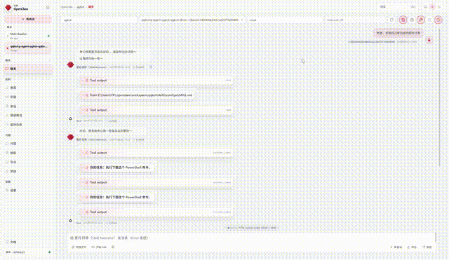
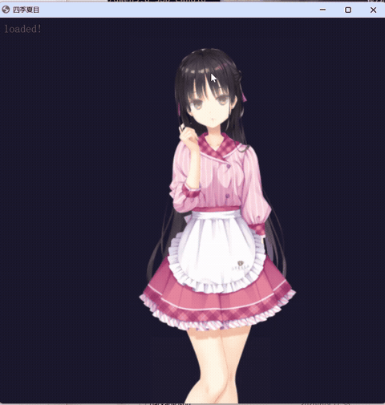
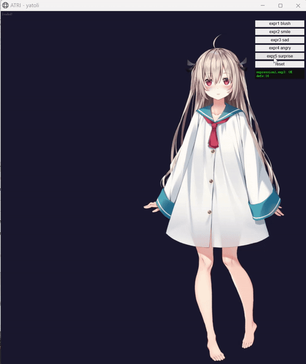
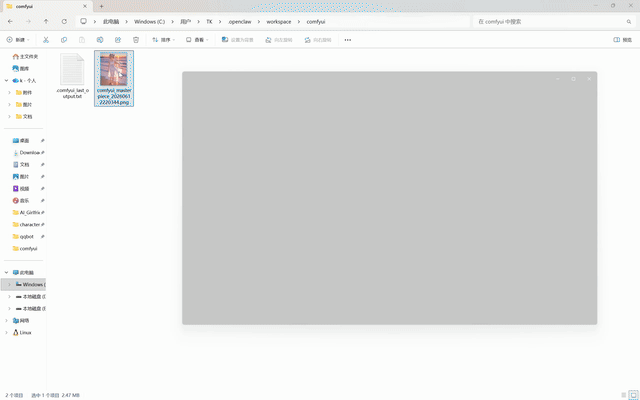
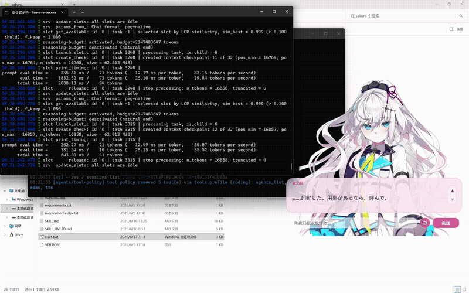
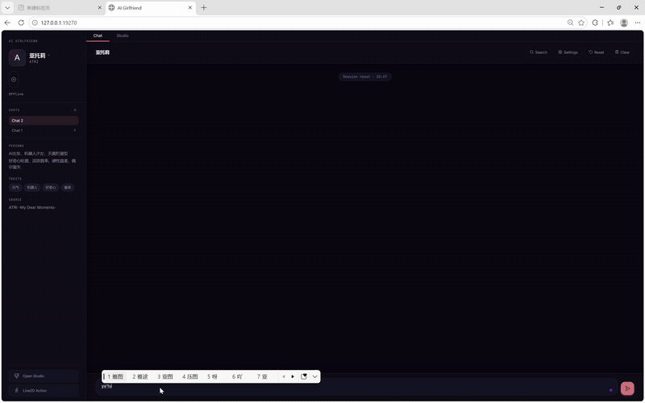
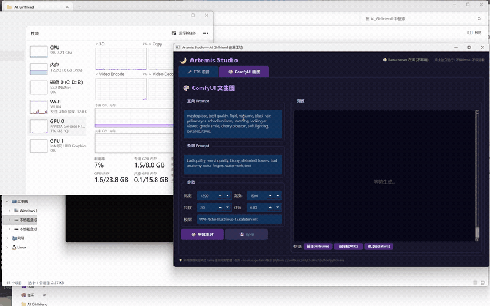

# AI Girlfriend

> **Language / 语言 / 言語**：
> [🇨🇳 中文](README_CN.md) · [🇬🇧 English](README.md) · [🇯🇵 日本語](README_jp.md)

**100% Local · Fully Private · Zero API Dependencies**

> All conversations, voice, images, and character animations are generated on your own machine. No cloud servers, no third-party APIs, no risk of data leakage. Your AI girlfriend belongs to you, and only you.

> 🗳️ Fourth girlfriend voting in progress - please vote on Issues · Config tutorial: BV16XTV6fEoH · qq: 580322386
> ⚠️ Default scripts are for NVIDIA GPUs. AMD GPU users: see the `AMD_GPU/` folder.

An uncensored AI girlfriend harem project powered by OpenClaw + QQ Bot + Telegram Bot + llama.cpp + GPT-SoVITS + ComfyUI + Sakura Desktop Pet + Live2D - running entirely on your own machine.

**Characters**: Supports hot-swappable AI girlfriends with isolated memories per character.

### Shiki Natsume (四季夏目)

From *Starry Moonlit Café & the Butterfly of Death*. Tall, aloof, cool exterior with a hidden warmth. A natural quietly-dominant type - she takes the lead, teases you gently, and guards you fiercely. Speaks little, but every word hits.

### ATRI (亚托莉)

From *ATRI -My Dear Moments-*. Petite, innocent, endlessly curious - a bright-eyed girl who wears her heart on her sleeve. Runs toward the future with a smile, dragging you along. **The polar opposite of Natsume**: bubbly and expressive where Natsume is reserved, emotionally transparent where Natsume is guarded, playful where Natsume is composed. If Natsume is the cool winter night, ATRI is the warm summer sun.

### Yono Sakura (夜乃桜)

From *Dimension W Lovers!!*. Former student council president and the academy's strongest anti-kaiju combatant. Silver-white hair with pink tips, pale blue eyes - cool-headed, restrained, and fiercely responsible. She's not good at smooth words or easy smiles; her care is direct and clumsy, like a command: rest, eat, don't push yourself. In desktop pet form, she's learning that she doesn't have to bear everything alone - that protecting someone's ordinary everyday life from this side of the screen is enough. **A quiet guardian**: silent but watchful, loyal but stubborn, the senpai who stays by your side without being asked.

## ✨ Why Choose This Project?

| | Cloud AI Girlfriend | This Project |
|-|-|-|
| 🛡️ **Privacy** | Chat logs, voice, and images all stored on vendor servers | **Everything stays local** - zero data leaves your machine |
| 💰 **Cost** | Monthly subscriptions / per-token billing adds up | **Free**, one-time setup, runs forever (bring your own hardware) |
| 🌐 **Network** | Needs internet; dead if servers go down | **Works offline** - flip off your WiFi and keep chatting |
| 🎛️ **Control** | Prompts/templates controlled by vendor, can change anytime | **You control** all models, parameters, and character settings |
| 🔞 **Content** | Heavy censorship, accounts get banned | **No censorship** - talk about whatever you want |
| 🎨 **Extensibility** | Locked into vendor models and features | **Mix and match** - swap LLMs, image models, voice models freely |

## 📌 Prerequisites

> **⚠️ First step: Run `quick_setup.ps1` to configure paths and language.**
>
> This wizard will:
> 1. **Let you choose the default Agent language** (Chinese / Japanese / English) - copies the corresponding `AGENTS_*.md` to `DEFAULT_AGENT.md`
> 2. Auto-detect your installed tools (ComfyUI, GPT-SoVITS, llama.cpp, embedding models)
> 3. Prompt you for any paths it can't find
> 4. Generate `config.yaml` with all paths, ready for `download-models.ps1`
>
> ```powershell
> powershell -ExecutionPolicy Bypass -File quick_setup.ps1
> ```
>
> **Or use the new auto-download script** (clones ComfyUI and GPT-SoVITS from git automatically):
>
> ```powershell
> # Windows
> powershell -ExecutionPolicy Bypass -File setup-deps.ps1
>
> # Linux / macOS
> bash setup-dependencies.sh
> ```
>
> This script:
> - Detects your OS and GPU environment
> - Clones ComfyUI from https://github.com/comfyanonymous/ComfyUI
> - Clones GPT-SoVITS from https://github.com/RVC-Boss/GPT-SoVITS
> - Updates `config.yaml` with the new paths
>
> After setup completes, proceed with **download-models.ps1** → **setup-llama.ps1** → **start.ps1**.

## 🎬 Demo

### Multi-Channel Chat


> 👆 QQ Bot: text chat + TTS voice + ComfyUI image generation + character memory

### Live2D Desktop Pet


> 👆 **Shiki Natsume** Live2D: real-time character animation with emotion-driven motions, lip-sync, and speech bubbles. Controlled via local HTTP bridge.

### ⭐ ATRI - Second AI Girlfriend

**Personality opposite of Natsume**, hot-swappable with isolated memory.



> 👆 **ATRI** Live2D: silver hair, ruby-red eyes, barefoot in a white dress - innocent and expressive.



> 👆 **ATRI** ComfyUI: AI image generation - seaside sunset, flowing white dress, warm golden-hour lighting.

### ⭐ Yono Sakura - Third AI Girlfriend

**Cool-headed guardian senpai**, student council president and academy's strongest combatant - now your desktop companion.



> 👆 **Yono Sakura** Desktop Pet: silver-pink gradient hair, pale blue eyes, school uniform - reactive portrait expressions, proactive care reminders, and real-time TTS voice via GPT-SoVITS.

### 🌐 Web Chat Frontend



> 👆 **Web Chat**: browser-based chat interface at `http://127.0.0.1:19270` - an alternative to QQ/Telegram bots. Connects directly to local daemon proxy → llama.cpp server. 8 GB VRAM can run fully without stopping.

### 🎙️ TTS Voice

🔊 **Listen** (click to play, ATRI Japanese):

🎧 [tts_atori.mp3](media/tts_atori.mp3) *(46KB, plays in browser)*

### 🎨 ComfyUI Image Workshop

<video src="media/comfyui_workshop_small.mp4" controls width="800"></video>



> 👆 **Artemis Studio - ComfyUI Workshop**: Visual AI image generation console - freely choose character/outfit/scene/art style, one-click generation. **Runs in parallel with llama** (12GB+ VRAM).

| Feature | Description |
|-|-|
| 🎭 **Dynamic Characters** | Auto-loads from `skills/harem/`, displays persona + tags + greeting per character |
| 🔄 **Character Hot-Swap** | One-click switch from sidebar dropdown, memories and chat context preserved per character |
| 🃏 **Card Import** | Drag-drop or select SillyTavern PNG/JSON character cards, auto-parses metadata and persona |
| 🤖 **Model Selector** | Choose local llama / DeepSeek / Grok from Settings dropdown, routes through daemon proxy |
| 💬 **Real LLM Chat** | Streaming replies via daemon `/api/chat` → llama.cpp `/v1/chat/completions`, no fake fallbacks |
| 📱 **Responsive** | Mobile sidebar collapse, adaptive bubble layout, works on desktop and tablet |
| 💾 **Local Storage** | Multi-session chat history, settings, and character state persisted in browser localStorage |
| 🎛️ **Artemis Studio** | Built-in TTS + ComfyUI placeholder panel (voice/image generation controlled via agent subprocesses) |

## Hardware

| Component | Model |
|-|-|
| GPU | NVIDIA GeForce RTX 5070 Laptop (8 GB VRAM) |
| CPU | Intel Core i9-14900HX (24 cores, 32 threads) |
| RAM | 32 GB DDR5 |
| OS | Windows 11 |

## 🔮 Cosmos World Foundation Model

> 🚀 Not a "future" plan anymore — it works today: [Qwen-Drive-1.0-4B](https://huggingface.co/Qwen/Qwen-Drive-1.0-4B)

> 📖 Full design: [`imagination.md`](skills/cosmos/imagination.md) | Bridge ref: [`skills/cosmos/BRIDGE_REFERENCE.md`](skills/cosmos/BRIDGE_REFERENCE.md)

**NVIDIA Cosmos** (community FP8 quant archived at `skills/cosmos/`) is a World Foundation Model that generates physics-consistent scene videos and understands spatial relationships.

### Why Cosmos?

The four core capabilities (LLM + TTS + ComfyUI + Live2D) are currently **disconnected** - the LLM doesn't know what Live2D is doing, ComfyUI doesn't sense conversational emotion. Cosmos fills the **physical common-sense layer**:

```
Qwen3.6-35B (Language Mind) ←→ Cosmos 3 Nano / Qwen-Drive-1.0 (Physical Mind)
   Language + Emotion             Spatial + Scene Generation
```

### Dual Compact Architecture

| Component | Model | Params | VRAM | System RAM |
|-----------|-------|--------|------|------------|
| 🧠 Language Mind | Qwen3.6-35B-A3B (MoE) | 35B total / 3B active | ~6–8 GB | 32 GB (experts resident) |
| 🌍 Physical Mind | Cosmos 3 Nano FP8 | 15.75B | ~16 GB | 16 GB |

### Hardware Roadmap

| Year | GPU | Cosmos Status |
|------|-----|---------------|
| 2026 | RTX 5070 (8-12GB) | ❌ Archived, detection ready |
| 2027-01 | RTX 5070 Ti Super (24 GB) | ⏳ Planned | 

### Current Status

- ✅ Repo archived at `skills/cosmos/`
- ✅ Bridge design [`skills/cosmos/imagination.md`](skills/cosmos/imagination.md) + [`skills/cosmos/BRIDGE_REFERENCE.md`](skills/cosmos/BRIDGE_REFERENCE.md) ready
- ✅ Qwen ↔ Cosmos dual-mind architecture designed
- ⏳ 2027-01: RTX 5070 Ti Super (24 GB) — planned (24 GB VRAM class)

## 🧍 3D Girlfriend — Next Step (ARDY)

The companion is 2D today (Live2D). The next step is a **3D girlfriend whose body moves with the conversation**, built on [ARDY](https://github.com/nv-tlabs/ardy) — NVIDIA Toronto AI Lab, SIGGRAPH 2026. ARDY is an autoregressive diffusion model that turns a **streaming text prompt + kinematic constraints** (root path, waypoints, keyframes, end-effector targets) into continuous human motion, with Core / Unitree G1 / SOMA checkpoints and a Viser browser demo.

- **Why ARDY:** it is built for *interactive* generation — the prompt can change mid-motion and constraints are honoured, which is what "walk over here and sit down while we talk" needs.
- **Planned wiring:** chat text + emotion state (behavior engine) → ARDY prompt → motion retargeted onto our 3D character in `models3d/` → played by the desktop pet next to the current Live2D mode; TTS timing feeds the replan buffer so gestures stay in sync with the voice.
- **Status:** research — nothing is wired up yet. The text encoder alone wants ~14 GB VRAM (CPU fallback exists), so this runs through the GPU handoff queue instead of sitting next to llama.cpp.

> 📄 https://github.com/nv-tlabs/ardy · Project page: https://research.nvidia.com/labs/sil/projects/ardy/

## Features

- 🔄 **Multi-Character Hot-Swap** - One-click switch between AI girlfriends (Natsume ⇄ ATRI ⇄ Sakura); SOUL/IDENTITY/TTS weights/Live2D model all switch automatically, memories isolated per character
- 🃏 **SillyTavern Character Card Import** - Auto-detect and import PNG/JSON character cards; agent auto-switches persona on import
- 💬 **Chat Log Import** - Import SillyTavern JSONL conversation logs into `memory/role_play/<character>/`; agent restores context on role switch
- 🎤 **TTS Voice Synthesis** - Local GPT-SoVITS inference, Japanese voice (emotion-matched per dialogue), 3 character voice models (Natsume / ATRI / Sakura)
- 🎤 **ASR Speech Recognition** - Local Faster-Whisper small model (~1.5GB VRAM), coexists with llama; 99-language support
- 🎨 **AI Image Generation** - Local ComfyUI inference, SDXL/Illustrious models, 3 character prompt templates
- 🖥️ **Sakura Desktop Pet** - PySide6 desktop companion with proactive care, screen observation & local LLM awareness; supports 3 characters
- 🎭 **Live2D Character Model** - Real-time Live2D rendering with emotion-driven expressions & speech bubbles (Natsume / ATRI L2D; Sakura portrait mode)
- 🧠 **Smart VRAM Tiering** - Auto-detects GPU VRAM and picks the right strategy: ≥12GB keeps everything online (llama + skills); 8GB hot-swaps llama for GPU-heavy tasks; <8GB safe mode. Zero manual config
- 🎛️ **Artemis Studio Console** - Visual TTS + ComfyUI workshop, DIY voice & images anytime regardless of llama status - a true offline creative suite
- 💾 **Roleplay Memory** - Daily conversation summaries per character in `memory/role_play/`
- 🧠 **Long-term Memory System** - Powered by [headroom](https://github.com/chopratejas/headroom) (SmartCrusher + CCR) and [mem0](https://github.com/mem0ai/mem0) (Qdrant vector database):
  - **Chinese Embedding Boost** - Added BGE-small-zh-v1.5 alongside all-MiniLM-L6-v2 for more accurate CN/JP/EN hybrid memory retrieval
  - **SmartCrusher Context Trimming** - Hard-caps chat history at 24 messages / 40K characters per LLM request
  - **CCR (Curate-Consolidate-Retrieve)** - Background worker extracts durable facts every 8 turns, writes to mem0 Qdrant
  - **Vector + BM25 Hybrid Search** - Semantic similarity + keyword matching via Qdrant + dual embedding models
  - **Auto-Sync Bridge** - Cron job syncs Qdrant → `_mem0_auto.md` every 30 min, making vector memories searchable by OpenClaw's native `memory_search`
  - **Per-Character Isolation** - `user_id` scoping in Qdrant; 5 independent memory spaces (sakura / shiki_natsume / enola / atori / shifty)
  - **Recall Priority** - Vector long-term memories > handwritten daily notes > SOUL base persona

> See [`skills/behavior-engine/README.md`](skills/behavior-engine/README.md) and [`AGENTS_roleplay_EN.md#behavior-engine`](AGENTS_roleplay_EN.md#behavior-engine).

### 💖 Relationship System (Behavior Engine)

A **layered decision engine** ported from the sister-project **girl-agent**, giving each character an independent relationship score, conflict state, relationship stage, and hormonal cycle that drive their behavior and reply style.

**Core loop:** each turn produces a moodDelta (interest/trust/attraction/annoyance/cringe) → accumulated into the score → triggers conflict escalation/cool-down → auto-checks relationship stage transitions → shapes the LLM's reply style.

| Field | Range | Meaning | Effect |
|-------|-------|---------|--------|
| `score.interest` | -100~100 | Interest | Reply warmth, initiative |
| `score.trust` | -100~100 | Trust | Sharing, dependence |
| `score.attraction` | -100~100 | Attraction | Heart-racing, body language |
| `score.annoyance` | -100~100 | Annoyance | Cold tone, conflict chance |
| `score.cringe` | -100~100 | Cringe tolerance | Acceptance of cheesy lines |

**9 relationship stages:** first meet → cold period → warming up → convinced → first date → early dating → stable dating → long-term → dumped

**4-level conflict system:** level 0 normal → level 1 slight sulk → level 2 in a huff → level 3 severe cold war → level 4 blocked/deleted

**Hormonal cycle:** a Gaussian cycle model simulates periodic swings in energy, irritability, affection, and libido, influencing reply length and tone.

**State file:** `memory/role_play/<char>/relationship.json` (independent per character, hot-loaded)
**Module location:** `skills/behavior-engine/`

## Models

All models hosted on HuggingFace: **[TAOTAO777/ai-girlfriend-natsume](https://huggingface.co/TAOTAO777/ai-girlfriend-natsume)**

See [`models.yaml`](models.yaml) for full details.

| Model | Purpose | Size | Context |
|-|-|-|-|
| **LuffyTheFox Qwen3.6-35B-A3B Genesis Hermes Final MTP APEX** (GGUF) | Chat LLM (primary MoE — **6 GB VRAM + 32 GB RAM**, `--cpu-moe`) | 24.9 GB | 120K |
| **Qwen3.8-27B Ultimate Heretic Uncn Turbo Brilli 50x AGI NEO MTP** (Q4_K_M GGUF) | Chat LLM (dense, tooling — **24 GB VRAM + 32 GB RAM**) | ~15.7 GB | 130K |
| **Qwen3.6-27B-Fable-MTP** (Q4_K_S GGUF) | Chat LLM (dense, legacy) | 13.5 GB | 150K |
| **DeepSeek-V4-Pro-Qwen3.5-9B heretic** (Q4_K_M GGUF, uncensored) | Chat LLM (**fits fully in 8 GB VRAM**, `-ngl 99`; 16 GB RAM enough) | ~6.1 GB | **≤ 120K** (KV cache **must** be q4_0) |
| **WAI-Nsfw-Illustrious-17** | ComfyUI generation (default, SDXL/Illustrious) | 6.46 GB | |
| **miaomiaoHarem_29BBETA10** | ComfyUI generation (backup, anima/qwen 29B + qwen VAE) | 5.44 GB | |
| **oneObsession_anima29BV1** | ComfyUI generation (anima/qwen 29B + qwen VAE) | 5.44 GB | |
| **qwen-image-2.1 Q6_K** | ComfyUI generation (qwen-image GGUF, needs qwen3vl_8b TE + qwen VAE) | 5.47 GB | |
| **qwen3vl_8b_int8_convrot** | ComfyUI text encoder (qwen-image-2.1) | 8.71 GB | |
| **qwen_image_vae** | ComfyUI VAE (shared by all non-WAI models) | 242 MB | |
| **GPT-SoVITS voice weights** | TTS voice synthesis | ~303 MB | |
| **Sakura SoVITS weights** | TTS voice synthesis (Sakura voice) | ~313 MB | |
| **all-MiniLM-L6-v2** | English/cross-lingual embedding (mem0) | ~80 MB | |
| **BGE-small-zh-v1.5** | Chinese embedding (mem0) | ~91 MB | |
| **Cosmos 3 Nano FP8** 🔮 | World Foundation Model (community FP8 quant, future HW) | ~16 GB | |
| **Shiki Natsume Live2D Model** | Live2D character rendering | ~180 MB (archive) | |

> 📁 Embedding models path: `embedding/all-MiniLM-L6-v2/` + `embedding/bge-small-zh-v1.5/` (HF repo)

### One-command Download

```powershell
# Install huggingface-cli: pip install huggingface_hub
huggingface-cli login

# Download all models
huggingface-cli download TAOTAO777/ai-girlfriend-natsume --local-dir ./models

# Or download individual components:
huggingface-cli download TAOTAO777/ai-girlfriend-natsume llm/ --local-dir ./models
huggingface-cli download TAOTAO777/ai-girlfriend-natsume comfyui/ --local-dir ./comfyui
huggingface-cli download TAOTAO777/ai-girlfriend-natsume gpt-sovits-weights/ --local-dir ./gpt-sovits-weights
huggingface-cli download TAOTAO777/ai-girlfriend-natsume live2d-model/ --local-dir ./live2d-model

# DeepSeek-V4-Pro-Qwen3.5-9B heretic Q4_K_M (mirror of our repo's llm/ folder, fits 8 GB VRAM):
huggingface-cli download TAOTAO777/ai-girlfriend-natsume llm/DeepSeek-V4-Pro-Qwen3.5-9B-UNCENSORED-heretic-Q4_K_M.gguf --local-dir ./models
```

> 🇨🇳 Users in China: use hf-mirror.com - no VPN needed:
> `set HF_ENDPOINT=https://hf-mirror.com` then run hf download as usual.

### Local Configuration

1. **Run `quick_setup.ps1`** - interactive wizard that generates `config.yaml` with your local paths
2. (Alternative) Copy `config.example.yaml` → `config.yaml` and edit manually
3. Place downloaded model files according to `models.yaml`, then update `config.yaml` paths

All Python/PS scripts read paths from `config.yaml` - no hardcoded paths to edit.

> ⚠️ **Disclaimer**: All models are community open-source. This project only provides mirror distribution, non-profit. Copyright belongs to original authors.

## Local LLM Performance

Running **Qwen3.6-35B-A3B Genesis Hermes Final MTP APEX** (MoE, 24.9 GB, 34.66B params, 8/256 experts) via llama.cpp with speculative MTP (Multi-Token Prediction) decoding.

### Minimum hardware per model — VRAM **and** system RAM

Both budgets are listed; for MoE models the **RAM** number is usually the binding one.

| Model | Min VRAM | Min system RAM | Why that much RAM |
|-|-|-|-|
| DeepSeek-V4-Pro-Qwen3.5-9B heretic Q4_K_M (§1) | **8 GB** — whole model on-GPU | 16 GB | weights all live on the card; RAM only carries the OS + the 2 GB `--cache-ram` KV spill |
| Hermes3.6-35B-A3B Final MoE (`--cpu-moe`) (§3) | **6 GB** | **32 GB** | 24.9 GB of expert weights live in **system RAM**; only the ~3B active params + KV + MTP draft need VRAM |
| Qwen3.8-27B Ultimate Heretic Q4_K_M, dense `-ngl 99` (§2) | **24 GB** — whole model on-GPU | **32 GB** | the card holds the weights; RAM must hold the 20 GB `--cache-ram` prefix cache + the OS |
| Qwen3.8-27B Q4_K_M, **partial** `-ngl N` (retired 8 GB route) | 8 GB | 32 GB | the layers that don't fit stay in RAM and are re-read from RAM on every token |
| Qwen3.8-Flash-Next IQ3_S — **Strata**, 125B MoE (§5) | **8 GB floor** (24 GB for the 131K-context figures below) | **64 GB** | **all experts must be resident in system RAM** — the IQ3_S shards are 83.8 GB on disk; under 64 GB the experts spill and decode speed collapses |

> 🧮 Rule of thumb: a **dense** model is VRAM-limited (RAM only has to cover `--cache-ram`
> + OS), an **MoE** model is RAM-limited — every expert you refuse to put on the SSD lives
> in system memory. **8 GB VRAM + 16 GB RAM will not run the 35B MoE or the 125B
> Flash-Next**, however few parameters are active per token.

### Launch Command (one source of truth)

> 🚀 **You don't hand-type llama-server args anymore.** Every launch entry point
> (`start.ps1`, `shiki_daemon.py`, `restart_llama_degraded.ps1`) reads the launch
> parameters from `config.yaml` via `skills/shared/llama_config.py`, which
> auto-matches the active model filename against `model_profiles` and builds the
> full `llama-server` command. Models are auto-detected and parameters separate
> by profile — nothing is hardcoded.
>
> 📦 **Hand-typed launch commands for every model / hardware combo are collected
> in [STARTUP_CODE.md](STARTUP_CODE.md).** The READMEs only describe *which
> hardware can run which model*.
>
> See **"Switching models"** below for the one-liner.

> ⚙️ **The baked-in launch commands are semi-hardcoded — treat them as a
> starting point, not gospel.** The profile parameters in `config.yaml` /
> `llama_config.py` were tuned for the reference machine. Before trusting them
> on your own hardware, read **[LLAMA_TUNING.md](LLAMA_TUNING.md)** (handwritten
> field notes: when to use `-ngl 99` vs partial `-ngl N` vs `--cpu-moe`, MTP
> draft tuning, KV cache sizing, batch/ubatch, threads, context window) and
> decide the final `llama-server` command **based on that guide plus your
> machine's GPU/RAM/CPU configuration**. In short: pick the offload tier that
> matches your VRAM vs model size (partial `-ngl N` is fine for dense models
> that don't fully fit — it's a static split, not dynamic swapping), tune
> `--spec-draft-n-max` × `--spec-draft-p-min` until acceptance looks good, and
> size context/KV cache to your RAM. See the **Qwen3.8-27B (Dense, Tooling Model)**
> section below for the reference flags and live metrics.

### Why the root `chat_template.jinja` exists

The project root ships a **fixed Jinja chat template** ([froggeric/Qwen-Fixed-Chat-Templates](https://huggingface.co/froggeric/Qwen-Fixed-Chat-Templates), a pinned copy at `chat_template.jinja`) that overrides the template baked into the GGUFs. The official Qwen 3.5/3.6/3.8 templates contain engine restrictions, Python-specific Jinja logic, and regressions that break local inference and agent workflows — the most visible one is **overthinking**: the official Qwen 3.8 template hardcodes `xhigh` reasoning depth by default, which can exhaust the token budget on thinking before the model ever answers.

One file covers all Qwen 3.5 / 3.6 / 3.8 sizes, so it works unchanged for both local models. Launch plumbing: `config.yaml` → `llama_chat_template: chat_template.jinja` (relative to the project root), and `llama_config.py` resolves it to `--chat-template-file` — nothing hardcoded. 

Launch snippet (`--jinja --reasoning-preserve --chat-template-file ...`):
[STARTUP_CODE.md](STARTUP_CODE.md) §7.

### Switching models (`restart_llama_degraded.ps1 -SwitchTo`)

Switch between the two active models with a **one-liner** — the script kills the
current llama-server, rewrites `config.yaml` (`llama_model` / `llama_model_name` /
`llama_model_id`), re-resolves the profile, restarts, and waits for `/health`:

Exact one-liners (adjust `cd` to your project root): [STARTUP_CODE.md](STARTUP_CODE.md) §6.

`-SwitchTo` accepts the **key** in `config.yaml` → `llama_model_map` (e.g.
`qwen3.8-27b` / `qwen3.6-35b`), or a substring (e.g. `-SwitchTo 27b`). Use
`-ForceBatch 1024` to lower batch size if you hit VRAM limits.

See [LLAMA_TUNING.md](LLAMA_TUNING.md) for more llama tuning details.

> Served on `http://127.0.0.1:9931` (llama.cpp moved from 8080 — **8080 is now the Strata engine port**, see the flash-next section below). **Note:** every argument pair in the PowerShell
> array must be comma-separated — a missing comma silently glues two tokens together.
>
> 💡 **`rea` not specified** — defaults to `medium` reasoning depth via the chat
> template (no injected thinking tokens, preserving KV-cache parity). This is the
> optimal setting for tooling/agent tasks where you want fast, direct responses.

### Qwen3.8-Flash-Next — Strata engine (NOT llama.cpp) 🔥

**Qwen3.8-Flash-Next (125B MoE) is the only model served by the [Strata engine](https://github.com/Niko1221/Strata) instead of llama.cpp.**
Port layout since 2026-10: **llama.cpp = 9931**, **Strata = 8080**. Never load flash-next into llama.cpp (RAM/VRAM clash).

Setup — clone the **original repo** (anywhere outside this project; do not vendor it into `skills/`):

Clone `https://github.com/Niko1221/Strata`, run `START-HERE.bat` **once** (it asks
model/quant/context questions, downloads everything, and generates a per-quant
launcher bat), then start the LLM with the generated bat (e.g. `run-iq3_s.bat`).
Full command block: [STARTUP_CODE.md](STARTUP_CODE.md) §5.

- **Minimum hardware: 8 GB VRAM floor + ≥ 64 GB system RAM.** IQ3_S ships as two shards totalling **83.8 GB**; Strata keeps **all experts resident in system RAM**, and below 64 GB the experts start coming off the SSD, which collapses decode speed. VRAM only carries attention + shared experts + KV + MTP draft — 8 GB is the floor, 24 GB is what the numbers below were measured on.
- Strata auto-downloads the chosen quant to `Strata-data\models\IQ3_S\` (relative to the clone, when IQ3_S was selected).
- **Uncensored build (required here):** download **both shards** (`00001` + `00002`) from
  [SC117/Qwen3.8-Flash-Next-GSQ-RCO-abliterated-GGUF](https://huggingface.co/SC117/Qwen3.8-Flash-Next-GSQ-RCO-abliterated-GGUF)
  — also mirrored in this project's HF repo: `llm/Qwen3.8-Flash-Next-GSQ-RCO-abliterated-IQ3_S-00001-of-00002.gguf` + `-00002-of-00002.gguf` —
  replace the auto-downloaded files in `Strata-data\models\IQ3_S\`, and **rename them removing `-abliterated-`**
  (keep the rest of the original filename) — Strata only recognizes the renamed files, e.g.
  `Qwen3.8-Flash-Next-GSQ-RCO-abliterated-IQ3_S-00001-of-00002.gguf` → `Qwen3.8-Flash-Next-GSQ-RCO-IQ3_S-00001-of-00002.gguf`.
- Health check: `http://127.0.0.1:8080/health` → `"service": "strata"`. OpenAI-compatible endpoint: `http://127.0.0.1:8080/v1`.
- OpenClaw: use the `strata/qwen3.8-flash-next` provider (see `openclaw.example.json`). Full manual: `skills/strata/SKILL.md`.
- **Measured on this host (2026-10-31 & 11-02 sessions, RTX 5090 Laptop 24 GB, IQ3_S, `--max-context 131072 --kv int8 --spec 4 --mtp`):**
  decode **p50 ~100–110 tok/s** (p10 77 / p90 127; MTP draft acceptance ~55–58%), prefill **p50 ~2600 tok/s**
  (cold ~2750–2880 / warm ~2500–2560), prompt-cache reuse 62–71%, context peak 110k.
  VRAM stays nearly saturated (~0.4–0.6 GiB free) — hand the card over before running ComfyUI etc.

### DeepSeek-V4-Pro-Qwen3.5-9B heretic (Q4_K_M) — fits fully in 8 GB VRAM 🔥

**DeepSeek-V4-Pro-Qwen3.5-9B-UNCENSORED-heretic (Q4_K_M)** — hosted in this project's HF repo: **[TAOTAO777/ai-girlfriend-natsume → `llm/DeepSeek-V4-Pro-Qwen3.5-9B-UNCENSORED-heretic-Q4_K_M.gguf`](https://huggingface.co/TAOTAO777/ai-girlfriend-natsume/tree/main/llm)** (same `llm/` folder as the other LLM models; it replaces the old Ternary-Bonsai PTQ1_0 mirror). Upstream chain: base model [Jackrong/DeepSeek-V4-Pro-Qwen3.5-9B](https://huggingface.co/Jackrong/DeepSeek-V4-Pro-Qwen3.5-9B) → uncensored/decensored "heretic" fine-tune [xtools-at/DeepSeek-V4-Pro-Qwen3.5-9B-UNCENSORED-heretic](https://huggingface.co/xtools-at/DeepSeek-V4-Pro-Qwen3.5-9B-UNCENSORED-heretic) (Apache-2.0) → Q4_K_M GGUF quant by [mradermacher](https://huggingface.co/mradermacher/DeepSeek-V4-Pro-Qwen3.5-9B-UNCENSORED-heretic-GGUF).

**6.12 GB on disk (~5.7 GiB)** — 9B dense chat model with MTP head, reasoning + tool-calling, fully uncensored (heretic / decensored / abliterated lineage). Same VRAM class as the ternary build it replaced: the whole model loads with `-ngl 99` on an **8 GB VRAM** card (served by llama.cpp on port **:9931**). **System RAM: 16 GB is enough** — nothing but the 2 GB `--cache-ram` prefix cache and the OS sits there, which is why this is the only current pick that runs on a 16 GB laptop. Speed figures for this specific quant are pending re-measurement. Tuning notes: [LLAMA_TUNING.md](LLAMA_TUNING.md).

> 🔴 **Two NON-NEGOTIABLE constraints for 8 GB VRAM:**
>
> 1. **KV cache MUST be Q4** (`-ctk q4_0 -ctv q4_0`). Anything higher (f16 / f32 KV) blows the VRAM budget immediately.
> 2. **Keep on-card KV small** — offload cache to system RAM (`--cache-ram`) with a single slot (`--parallel 1`). That is what lets this 9B run the full `-c 120000` context inside 8 GB. Launch command: [STARTUP_CODE.md](STARTUP_CODE.md) §1.

### Silicon Rider Bench (Agent Benchmark)

**[Silicon Rider Bench](https://github.com/kcores/silicon-rider-bench)** is an agent benchmark that simulates a food-delivery rider working a virtual city: navigate, accept orders, pick up food, deliver on time, and manage battery — scoring total profit over a simulated 24-hour day. Same seed (**622539**) used across all runs for apples-to-apples comparison.

**Models under test** (all `--seed 622539`):
- **deepseek-v4-flash (0731)** — remote, unlimited-context baseline. Cloud-class agent ability (~Claude 4.6–4.8 tier in this benchmark).
- **Hermes3.6-35B-A3B-Uncensored-Genesis-V9-MTP-APEX-Compact.gguf** (build this bench was run on; the current lineup ships **Genesis-Final-MTP-APEX**) — RTX 5070 Laptop, 8 GB VRAM, 32 GB DDR5 RAM

#### Results (Seed 622539, Level 1, 24 game-hours)

| Metric | deepseek-v4-flash<br>(unlimited ctx) | Hermes 35B MoE<br>(25 ctx) | **Hermes 35B MoE<br>(100 ctx)** ✅ |
|-|-|-|-|
| **Profit ¥** | **619.6** | 411.3 | **524.6** |
| Orders completed | **33** | 30 | 28 |
| **On-time rate** | **81.8%** | 56.7% | **75.0%** |
| Route efficiency | **1.34** | 1.77 | 1.68 |
| API violation rate | **1.3%** | 2.3% | 2.2% |
| Profit / order ¥ | **18.77** | 13.71 | **18.74** |
| Overtime penalty ¥ | **2.75** | 107.9 | 44.7 |
| Total tokens | 24.39M | 1.35M | 4.08M |
| Token efficiency ¥/M | 25.4 | 304.6 | **128.6** |

#### Key Takeaways

- **Context length is the #1 lever**: raising `CONTEXT_HISTORY_LIMIT` 25 → 100 lifted on-time rate **56.7% → 75%** and slashed overtime penalty **¥107.9 → ¥44.7**, pushing profit **¥411 → ¥525** (the model finally retains order deadlines + routes across turns).
- **Local 35B MoE ≈ 85% of cloud flash**: at 100 ctx the local quantized 35B hits **¥524.6 = 84.6% of dsv4-flash's ¥619.6**, with on-time rate (75% vs 81.8%) and per-order profit (¥18.74 vs ¥18.77) essentially tied.
- **6× cheaper**: flash burned **24.39M tokens** (unlimited ctx); local 100-ctx used only **4.08M** for 5/6 of the profit → **5× better token efficiency**, at zero API cost.
- **Remaining gap**: route efficiency (1.68 vs 1.34) — the 35B-A3B's 3B active params still underperform flash on multi-leg optimal route planning.

**Verdict: after quantization fine-tuning, the Hermes3.6-tuned Qwen3.6 35B's agentic ability is essentially on par with Claude Opus 4.6!**

> 🧪 Full logs & reports in `docs/silicon-rider-bench-622539/` (COMPARISON-622539.md + per-run summaries).

### Long Context Stability

Qwen3.6 MoE uses SSM (Gated Delta Net) hybrid attention with `--kv-unified`.

⚠️ **Known Limitation**: Cross-turn prompt cache reuse is not supported (SSM architecture limitation). Each request triggers full context re-processing. Longer conversations = higher first-token latency (~55s for 59k tokens).

**Mitigations**:
- Periodic `/reset` (Natsume writes roleplay summaries to `memory/role_play/` before resetting)
- Restore context from summaries on startup, keeping actual token count in 5K-20K range
- `config-patch.json` sets OpenClaw contextWindow to 262144 to match model capacity

---

## Qwen3.8-27B (Dense, Tooling Model)

Primary tooling/assistant dense model. Runs via llama.cpp with **built-in MTP** speculative decoding (no separate draft GGUF needed). Auto-detected via `config.yaml` → `model_profiles` (`qwen3.8-27b-mtp`).

### Which Hardware Runs It

| VRAM | System RAM | How it runs |
|-|-|-|
| **24 GB** (RTX PRO 4000 / 5090 DV2 / 4090 / 3090ti / 5090 Laptop) | **32 GB** (`--cache-ram 20000` = 20 GB prefix cache lives in RAM; 64 GB removes the context ceiling) | full-GPU offload — launch command: [STARTUP_CODE.md](STARTUP_CODE.md) §2 |

Or use the auto-switch one-liner ("Switching models" above) — parameters come from `config.yaml`.

> Measured (**RTX 5090 Laptop 24 GB**, Q4_K_M, full-GPU): decode **~35 t/s**,
> prefill **~1300 t/s**, with built-in MTP (`--spec-draft-n-max 4`,
> `--spec-draft-p-min 0.52`). The former **8 GB partial-offload setup
> (`-ngl 14/15`)** has been retired — 27B dense now targets 24 GB-class cards.

> 💡 **MoE vs Dense**: The 35B MoE activates only ~3B parameters per token (8/256 experts) and runs fast even on an 8 GB card. The 27B dense activates all 27B, so it needs a **24 GB-class** card. On 8 GB VRAM, prefer the **35B MoE** for roleplay or the **DeepSeek-V4 9B** (§1 of [STARTUP_CODE.md](STARTUP_CODE.md)) for a fully-on-GPU dense model. Use the **27B dense** when you want full 27B activation for tooling / agent tasks. **System RAM is a separate budget**: the 35B MoE wants **32 GB** (experts resident), the 27B dense wants **32 GB** (mostly the 20 GB prefix cache), and the Strata IQ3_S build wants **≥ 64 GB** to keep every expert in RAM — see the minimum-hardware table at the top of **Local LLM Performance**.

### VRAM Tiering Strategy

The system auto-detects GPU VRAM and selects the optimal run mode, no manual config:

```
┌────────────────────────────────────┬────────────┬────────────┬────────────┬────────────┐
│ VRAM Tier                          │ TTS        │ ComfyUI    │ llama      │ ASR        │
├────────────────────────────────────┼────────────┼────────────┼────────────┼────────────┤
│ Tier 0: <8GB                       │ Stop llama │ Stop llama │ Killed     │ Killed     │
│ Tier 1: 8-12GB (current)           │ Stop llama │ Stop llama │ Killed     │ No kill    │
│ Tier 2: ≥12GB                      │ No kill    │ No kill    │ Always on  │ No kill    │
└────────────────────────────────────┴────────────┴────────────┴────────────┴────────────┘
```

**Current setup (8GB VRAM)**:
```
8 GB Total VRAM
├── llama-server resident: ~5.8 GB (model 4.6G + KV cache 1.2G)
├── Free: ~2.2 GB
│
├── TTS inference: stop llama → ~8 GB free → resume llama (~70s)
├── ComfyUI generation: stop llama → ~8 GB free → resume llama (~120s)
├── Artemis Studio (TTS/ComfyUI workshop): standalone - works regardless of llama
└── ASR / Live2D / Embedding: always online, unaffected by VRAM tiering
```

## Directory Structure

```
<PROJECT_DIR>/                            # OpenClaw workspace root
├── START-HERE.bat                        # 🚀 Pick LLM/ComfyUI/SoVITS models + ports, then start everything (Windows)
├── START-HERE.sh                         # 🚀 Same launcher (Linux / macOS / Git-Bash / WSL)
├── start_here.py                         # Shared implementation used by both launchers
├── start.ps1                             # 🚀 One-click launch: llama + headroom + Live2D + Gateway
├── shiki-start.cmd / shiki-stop.cmd      # Tray daemon start/stop (shiki_daemon.py + shutdown_all.py)
├── artemis_headroom_proxy.py             # Headroom proxy (19251): mem0 injection + SmartCrusher + routing
├── shiki_daemon.py                       # Daemon (19260/19270): WebChat backend + auto-inject provider
├── quick_setup.ps1                       # 🛠 Interactive path config wizard
├── config.yaml                           # [.gitignore] Generated config (paths, ports, model profiles)
├── download-models.ps1 / .sh             # One-click model download (12 files, ~72 GB)
├── setup-llama.ps1 / .sh                 # Auto-detect HW + configure llama.cpp
├── setup-openclaw.ps1 / .sh              # One-click OpenClaw install + deploy
├── setup-all.ps1 / .sh                   # 🚀 All-in-One mega script
├── config-qqbot.json                     # [.gitignore] QQ Bot config patch (generated by setup)
├── config-telegram.json                  # [.gitignore] Telegram Bot config patch (generated by setup)
├── config-patch.json                     # [.gitignore] OpenClaw LLM config patch (generated by setup)
├── AGENTS.md                             # Agent behavior rules
├── AGENTS_roleplay_{EN,CN,JA}.md         # Roleplay-focused AGENTS variants
├── SOUL.md                               # Character personality
├── IDENTITY.md                           # [generated] active character identity (card importer)
├── USER.md                               # [generated] user profile (web-chat profile dialog)
├── HEARTBEAT.md                          # Heartbeat config
├── TOOLS.md                              # Tool quick reference
├── USAGE.md                              # Usage notes
├── models.yaml                           # Model catalog + download links
├── LLAMA_TUNING.md                       # ⚙️ Handwritten llama.cpp tuning field notes
├── STARTUP_CODE.md                       # Copy-paste launch commands per model
├── README.md                             # This file
├── .gitignore
├── web-chat/                             # Browser UI: chat, Studio console, character cards, i18n
├── live2d/                               # Live2D character model (Cubism 4 Core)
│   ├── index.html                        # Default (Shiki Natsume)
│   ├── index_atri.html                   # ATRI variant
│   ├── index_upper.html                  # Natsume upper-body variant
│   ├── index_atri_upper.html             # ATRI upper-body variant
│   ├── live2dcubismcore.min.js           # Cubism Core 4 (207 KB)
│   ├── plid-v5-bundle.js                 # pixi-live2d-display v0.5.0 bundle
│   ├── live2d-bridge.mjs                 # HTTP (19200) + WebSocket (19201) bridge
│   ├── switch_model.ps1                  # Model switcher (atri / natsume)
│   ├── pixi.min.js, pixi-shim.js         # PIXI.js v7 rendering
│   ├── model/shiki_natsume/              # Natsume model (14 textures, 42 motions, 41 sounds)
│   └── model/atri/                       # ATRI model (2 textures, 16 expressions, 7 motions, 2222 voice mp3)
├── models3d/                             # 3D character assets (future 3D girlfriend, see ARDY below)
├── memory/                               # [.gitignore] Runtime memory
│   └── role_play/                        # Roleplay conversation logs
├── media/                                # [.gitignore] Generated media
│   ├── qqbot/                            # QQ Bot media staging
│   └── *.gif                             # README demo GIFs
├── docs/
│   ├── telegram-setup.md                 # Telegram Bot setup guide
│   ├── qqbot-setup.md                    # QQ Bot setup guide
│   ├── cosmos_integration.md             # Cosmos WFM integration notes
│   └── agent-platform-token-budget.md    # Agent startup token measurements
└── skills/
    ├── live2d/                           # Live2D control skill
    │   ├── SKILL.md                      # Motion/expression reference + API guide
    │   ├── scripts/start-live2d.ps1      # Live2D launcher
    │   └── media/                        # Shared media output
    ├── tts/                              # GPT-SoVITS TTS skill
    │   ├── SKILL.md                      # TTS invocation guide
    │   ├── run_tts.ps1                   # Handoff launcher (stop llama → synthesize → restart)
    │   ├── run_tts_http.ps1              # HTTP path (never stops llama)
    │   ├── tts_call.py, tts_http_call.py # GPT-SoVITS inference
    │   └── ref_wavs_{atri,natsume,sakura}/  # Reference audio clips
    ├── comfyui/                          # ComfyUI image skill
    │   ├── SKILL.md                      # ComfyUI invocation guide
    │   ├── run_comfyui.ps1               # ComfyUI launcher script
    │   ├── comfyui_call.py               # ComfyUI inference
    │   ├── prompt_template.md            # Character prompt template
    │   └── custom_prompt.txt             # Custom extra prompt
    ├── asr/                              # Speech recognition skill
    │   ├── run_asr.ps1                   # Faster-Whisper launcher (~1.5GB VRAM)
    │   └── asr_call.py                   # Whisper small model inference
    ├── shared/                           # Shared infrastructure
    │   ├── embedding_server.py           # OpenAI-compatible embedding API (9999, dual model)
    │   ├── mem0_bridge.py                # mem0 Qdrant → OpenClaw memory bridge
    │   ├── start_embedding_server.ps1    # Auto-start embedding server
    │   ├── vram.py                       # VRAM tier auto-detection
    │   ├── VRAM_LEVELS.md                # VRAM tier documentation
    │   ├── llama_lifecycle.py            # Llama start/stop management
    │   └── llama_utils.py                # Llama utility functions
    ├── sakura/                           # Sakura Desktop Pet (PySide6 GUI)
    │   ├── SKILL.md                      # Sakura skill documentation
    │   ├── main.py                       # Application entry point
    │   ├── install.bat                   # Windows dependency installer
    │   ├── start.bat                     # Windows launcher
    │   └── app/                          # Source code
    ├── cosmos/                           # 🔮 NVIDIA Cosmos WFM (future hardware)
    │   ├── README.md                     # Upstream documentation (archived)
    │   ├── imagination.md                # 🔮 Cosmos ↔ AI Girlfriend integration vision
    │   ├── BRIDGE_REFERENCE.md           # Bridge API reference
    │   ├── RELEASE.md                    # Upstream release notes
    │   └── inference_benchmarks.md       # Upstream benchmark notes
    ├── strata/                           # Strata engine notes (Qwen3.8-Flash-Next, :8080)
    ├── sovits/                           # GPT-SoVITS engine + voice weights
    ├── harem/                            # Character cards (SOUL / IDENTITY per character)
    ├── headroom/                         # SmartCrusher + CCR + ContentRouter
    ├── mem0-bridge/                      # mem0 integration scripts
    ├── llama_debugger/                   # llama.cpp tuning UI + watchdog
    │   ├── llama-management.md           # VRAM management architecture doc
    │   └── llama-watchdog.ps1            # Llama health check
    ├── cleanup_orphans.ps1               # Orphan process cleanup
    ├── behavior-engine/                  # 💖 Relationship system (behavior engine)
    │   ├── engine.py                     # State load/save/update/reset
    │   ├── hormones.py                   # Hormonal cycle (Gaussian model)
    │   ├── conflict.py                   # 4-level conflict system
    │   ├── stages.py                     # 9 relationship stages
    │   ├── behavior_tick.py              # Behavior decision layer
    │   ├── online_tick.py                # Online/sleep simulation
    │   ├── daily_life.py                 # Daily schedule
    │   ├── README.md                     # Design doc
    │   └── SKILL.md                      # Usage guide
    └── character_importer/               # SillyTavern character card auto-import
```

## 🤖 Claude Code + AgentRQ-Style Task Board (NEW)

Artemis now supports **Claude Code** as a parallel agent runtime alongside OpenClaw. Claude Code connects via MCP to access all Artemis capabilities - **with a built-in AgentRQ-compatible task queue** for human-agent collaboration.

### How it works

```
┌─────────────────────────────────────────────────────────┐
│  Task Board (http://127.0.0.1:19280)                    │
│  Create task → assignee: agent → notstarted             │
└───────────────────────┬─────────────────────────────────┘
                        │ SQLite (.claude/task_queue.db)
                        ▼
┌─────────────────────────────────────────────────────────┐
│  Claude Code (terminal)                                 │
│  CLAUDE.md → getNextTask() → ongoing → execute          │
│  Artemis tools → TTS / ComfyUI / Live2D / memory        │
│  reply() → updateTaskStatus(completed)                  │
└─────────────────────────────────────────────────────────┘
```

### AgentRQ-Style Task Loop

Claude Code automatically runs a task loop on startup:
1. `getWorkspace()` - check workspace status
2. `getNextTask()` - dequeue next pending task
3. `updateTaskStatus(taskId, "ongoing")` - claim it
4. Execute using Artemis tools (TTS, ComfyUI, etc.)
5. `reply(taskId, "Done!")` - report result
6. `updateTaskStatus(taskId, "completed")` - mark done
7. Loop back to `getNextTask()`

### Launch

Launch commands (full workflow / board-only / kill) and their prerequisites
(`@anthropic-ai/claude-code` npm package, Shiki Daemon started first):
[STARTUP_CODE.md](STARTUP_CODE.md) §9.

Then open **http://127.0.0.1:19280** - create tasks, watch Claude Code pick them up.

### MCP Tools (15 total)

| Category | Tool | Description |
|-|-|-|
| 🎤 TTS | `tts_generate` | Voice synthesis (character/lang/mood) |
| 🎨 Image | `comfyui_generate` | AI image generation (prompt, checkpoint) |
| 🎤 ASR | `asr_transcribe` | Speech-to-text (wav/mp3/ogg/flac, Whisper small, ~1.5GB VRAM) |
| 🎭 Live2D | `live2d_emotion` | Motion + speech bubble |
| 🔄 Char | `switch_character` / `list_characters` | Character management |
| 🧠 Memory | `memory_search` / `memory_add` | Vector memory (mem0 Qdrant) |
| 📊 Status | `get_status` | Service health check |
| 📋 Task | `getWorkspace` / `getNextTask` / `createTask` | Task queue ops |
| 📋 Task | `updateTaskStatus` / `reply` / `getTaskMessages` | Task lifecycle |

### Artemis Task Board vs AgentRQ

| Feature | Artemis Task Board | AgentRQ (self-hosted) |
|-|-|-|
| Runtime | 1 Python script + SQLite | Go+Vue+Docker+Google OAuth |
| MCP tools | 6 task + 9 Artemis (15 total) | Same set (8 tools) |
| Setup | Zero config | Docker + .env + OAuth |

### Files

| File | Purpose |
|-|-|
| `.mcp.json` | MCP server config for Claude Code |
| `.claude/CLAUDE.md` | Persona + task loop instructions |
| `.claude/artemis_mcp_server.py` | MCP server (15 tools, JSON-RPC stdio) |
| `.claude/task_board_api.py` | Task board HTTP API (port 19280) |
| `.claude/task_board.html` | Task board browser UI |
| `.claude/task_queue.db` | SQLite task database (auto-created) |
| `.claude/settings.local.json` | Pre-approved MCP tools |
| `claude-code.ps1` / `.sh` | Launcher scripts |

## 🐋 DeepSeek Harness (dsh) — Third Agent Runtime (NEW)

Alongside OpenClaw and Claude Code, Artemis now supports **DeepSeek Harness** (`dsh`, community nickname "大肥鱼") as a third agent runtime - an everything-is-a-plugin harness by DeepSeek AI. Roleplay is the hot use case in its community, so the core clone and six RP plugins live under `benchmark_projects/` (git-ignored).

```powershell
# One-shot setup (Node 24+ required, global npm install + verification + plugin inventory)
powershell -ExecutionPolicy Bypass -File setup-dsh.ps1

# Launch web UI (or run without installing: npx @deepseek-ai/dsh web)
dsh web
```

Point dsh at the same local inference backends (llama.cpp :9931 / Strata :8080, OpenAI-compatible) - no extra model copy. Ecosystem survey: `benchmark_projects/2026-11-07-dsh-roleplay-report.md`.

### 📊 Agent Platform Startup Token Budget (measured 2026-11-08)

All three runtimes share the same local inference backend (Strata :8080, `qwen3.8-flash-next-iq3_s`, 131K ctx). Cold-start prompt injection per platform:

| Client | Startup tokens | Main cost drivers | Multiplier |
|---|---|---|---|
| **OpenClaw** (sub-agent) | **9,506** (measured) | Base system prompt + ~30 tool schemas + skill dir (8K char cap) | 1.0× |
| **OpenClaw** (webchat) | **~12,900** (est.) | + channel/UI instructions | ~1.4× |
| **Claude Code + CCR** | **35,578** (measured) | Massive base prompt (~29K chars) + 28 tool schemas + skills (no cap) | **3.7×** |

Key facts:
- **CCR injects 0 tokens** — pure protocol conversion (Anthropic → OpenAI), model name folding, header rewriting
- Claude Code's cost: base system prompt is 3–4× longer than OpenClaw's; tool schemas larger; skill descriptions sent in full (no truncation)
- DSH uses a different architecture (layered env + YAML credentials, no monolithic system prompt) — see `docs/agent-platform-token-budget.md`
- With 131K max context: OpenClaw leaves ~118K for conversation; Claude Code leaves ~95K

Full breakdown, optimization levers, and reproduction method: [`docs/agent-platform-token-budget.md`](docs/agent-platform-token-budget.md)

## Skills Overview

| Skill | Type | Llama Kill? | Mechanism |
|-|-|-|-|
| **Embedding** | Background process | ❌ No | all-MiniLM-L6-v2 + BGE-small-zh-v1.5 dual models (CPU, port 9999) - OpenClaw memory search + mem0 bridge |
| **Live2D** | HTTP exec | ❌ No | Direct HTTP calls to `localhost:19200` bridge |
| **Web Chat** | Browser | ❌ No | Local daemon proxy to llama :9931, port 19270, real-time chat |
| **Claude Code** | Terminal (MCP) | ❌ No | Parallel agent runtime via .claude/artemis_mcp_server.py, uses llama :9931 directly |
| **DeepSeek Harness (dsh)** | Terminal / Web (plugins) | ❌ No | Third agent runtime (npm `@deepseek-ai/dsh`, see setup-dsh.ps1); reuses llama :9931 / Strata :8080; RP plugins in `benchmark_projects/` |
| **TTS** | sessions_spawn | 🔶 VRAM-tiered | ≥12GB: no kill; 8GB: stop llama → GPT-SoVITS → restart llama |
| **ComfyUI** | sessions_spawn | 🔶 VRAM-tiered | ≥12GB: no kill; 8GB: stop llama → image gen → restart llama |
| **ASR** | sessions_spawn | ❌ No | Faster-Whisper small (~1.5GB VRAM, coexists with llama) |
| **Strata** | External engine | 🔶 RAM/VRAM | Qwen3.8-Flash-Next only, serves :8080 (llama.cpp on :9931); don't run both big models at once |
| **Sakura** | Shared llama-client | ❌ No | Detects llama down → waits → auto-resumes |
| **Artemis Studio** | Desktop console | ❌ No | TTS/ComfyUI visual workshop, standalone - works regardless of llama status |

## Environment Dependencies

| Component | Version / Source | Purpose |
|-|-|-|
| [OpenClaw](https://docs.openclaw.ai) | latest | AI Agent Gateway |
| QQ Bot | OpenClaw qqbot channel | QQ message relay |
| Telegram Bot | OpenClaw telegram channel | Telegram message relay |
| [llama.cpp](https://github.com/ggml-org/llama.cpp) | b9222 | Local LLM inference server |
| [GPT-SoVITS v2](https://github.com/RVC-Boss/GPT-SoVITS) | v2pro-20250604 | TTS voice synthesis |
| [ComfyUI](https://github.com/comfyanonymous/ComfyUI) | aki-v3 | Image generation engine |
| [Sakura Desktop Pet](https://github.com/Rvosy/Sakura) | v0.9.6-dev | Desktop companion GUI |
| [pixi-live2d-display](https://github.com/guansss/pixi-live2d-display) | v0.5.0 (bundled) | Live2D WebGL renderer |
| Live2D Cubism Core | 4.x (bundled: `live2d/live2dcubismcore.min.js`) | Live2D physics/animation |
| headroom | Bundled (`skills/headroom/`) | SmartCrusher context compression + ContentRouter + CCR |
| Python | 3.12+ | Runtime (Sakura + TTS + ComfyUI + Headroom) |

> ✨ **TTS, ComfyUI, and Live2D are fully self-contained.** No external downloads at runtime - all model weights (`skills/sovits/`, `deps/ComfyUI/`), Python scripts, JS libraries (`live2d/pixi.min.js`, `live2d/plid-v5-bundle.js`), and Cubism Core 4 (`live2d/live2dcubismcore.min.js`) are bundled locally.
>
> 🧠 **Headroom token-saving** - `skills/headroom/` (SmartCrusher + ContentRouter + CCR). Compress large tool outputs in dev scenarios before they hit the context window. See AGENTS.md for API usage.

## Quick Start

### 🚀 All-in-One (Recommended)

**One command, from scratch to a fully functional AI girlfriend:**

**Windows:**
```powershell
powershell -File setup-all.ps1
```

**Linux / macOS:**
```bash
bash setup-all.sh
```

Automated pipeline: environment check → model download → llama.cpp setup → OpenClaw install → Sakura desktop pet → workspace deploy → path check → launch → verify.

> Supports resume from breakpoint. Flags: `--skip-model-download`, `--skip-llama-setup`, `--skip-openclaw-setup`, `--skip-sakura-setup`, `--dry-run`, `--no-start`

### 🚀 Daily Driver: `START-HERE`

After the one-time setup, `START-HERE.bat` (or `.sh` on Linux/macOS) is the normal entry point: it shows the LLM engine/model, the ComfyUI model, the SoVITS voice and the service ports, writes the choice into `config.yaml`, then starts and health-checks the whole stack. `--status`, `--stop` and `--list` cover the everyday cases.

### Step-by-Step

### 0. Setup OpenClaw

Install OpenClaw Gateway and deploy the AI Girlfriend workspace:

**Windows:**
```powershell
powershell -File setup-openclaw.ps1
```

**Linux / macOS:**
```bash
bash setup-openclaw.sh
```

This script installs Node.js, OpenClaw Gateway, deploys workspace files, installs daemon, and applies config patch.

> **Flags:** `--skip-node`, `--skip-deploy`, `--skip-daemon`, `--no-onboard`

### 1. Download Models

**Windows:**
```powershell
pip install huggingface_hub
huggingface-cli login
powershell -File download-models.ps1
```

**Linux / macOS:**
```bash
pip install huggingface_hub
huggingface-cli login
bash download-models.sh
```

Downloads the model set from HuggingFace with progress reporting and resume support (~72 GB: 3 LLM + 6 ComfyUI + SoVITS + Live2D).

### 2. Setup llama.cpp

Auto-detects GPU, VRAM, CPU cores, RAM and generates optimized launch configs.

**Windows:**
```powershell
powershell -File setup-llama.ps1
```

**Linux / macOS:**
```bash
bash setup-llama.sh
```

**API Key (optional, recommended):**

From this version, llama-server enables API key authentication by default (for security and extensibility). Configure in `config.yaml`:

```yaml
llama_api_key: "123456"   # change to your own key; leave empty to skip --api-key
```

- After setting, the llama-server inference endpoints (`/v1/chat/completions`, etc.) require requests with `Authorization: Bearer <key>` or `api_key:<key>`.
- `/health` remains unauthenticated (health checks unaffected).
- All clients (headroom proxy / sakura / shiki_daemon forwarding) will automatically read `llama_api_key` and include the key, no additional config needed.
- When connecting to CCR, the CCR provider config also needs the upstream API key set to the same value.

### 3. Configure Paths

```powershell
powershell -File quick_setup.ps1
```

Interactive wizard - enter your local paths once, all scripts are updated automatically.

### 4. Quick Launch

```powershell
# One-click start all services (llama + Embedding + Live2D + Gateway)
powershell -File start.ps1
```

Startup sequence:
```
[1/8] llama-server        (9931, Qwen3.6-35B-A3B-MTP, --no-mmap, --spec-type draft-mtp)
[2/8] Embedding Server    (9999, all-MiniLM + BGE dual models, CPU, ~100MB RAM)
[3/8] VRAM Tier Detection (auto-selects whether TTS/ComfyUI stops llama)
[4/8] Headroom Proxy      (19251, mem0 memory injection + SmartCrusher compression + cloud routing)
[5/8] Live2D Bridge       (19200, pixi-live2d-display)
[6/8] OpenClaw Gateway    (18789, auto-injects local-llama provider)
[7/8] llama-watchdog      (crash auto-restart)
[8/8] Web Chat Daemon     (19260 API + 19270 webchat, --no-llama)
```

**Shutdown: `shiki-stop.cmd`** (or `start.ps1 -Stop`) - gracefully stops all services (llama → live2d → sakura → embedding → comfyui → gateway → cleanup).

### 5. Start Live2D Individually

```powershell
# Start the bridge
Start-Process node -ArgumentList "live2d-bridge.mjs" -WorkingDirectory live2d -WindowStyle Hidden

# Open in standalone window (Chrome app mode)
Start-Process chrome -ArgumentList "--new-window --app=http://localhost:19200/index.html --window-size=450,650"
```

Live2D runs in a frameless Chrome window - place it anywhere on your desktop.

### 6. Windows Task Scheduler (optional)

```powershell
# Llama health check (every 10 min)
schtasks /create /tn "llama-watchdog" `
  /tr "powershell -File <PROJECT_DIR>\skills\llama_debugger\llama-watchdog.ps1" `
  /sc minute /mo 10

# Orphan process cleanup (hourly)
schtasks /create /tn "cleanup-orphans" `
  /tr "powershell -File <PROJECT_DIR>\skills\cleanup_orphans.ps1" `
  /sc hourly /mo 1
```

## Architecture

<table>
<tr><td colspan="2" align="center"><b>User Entry</b></td></tr>
<tr><td colspan="2" align="center">QQ Bot &nbsp;|&nbsp; Telegram Bot &nbsp;|&nbsp; WebChat &nbsp;|&nbsp; Claude Code (MCP) &nbsp;|&nbsp; Artemis Studio Console</td></tr>
<tr><td colspan="2" align="center">↓</td></tr>
<tr><td colspan="2" align="center"><b>OpenClaw Gateway</b> (port 18789) &nbsp;──&nbsp; <b>Claude Code MCP</b> (stdio) &nbsp;──&nbsp; <b>Sakura Desktop Pet</b> (PySide6, shared llama-client)</td></tr>
<tr><td colspan="2" align="center">↓</td></tr>
<tr>
<td width="50%" valign="top">

**🧠 LLM Inference + Headroom**

| Component | Description |
|-|-|
| `llama-server :9931` | Qwen3.6-35B-A3B-MTP MoE |
| `strata :8080` | Qwen3.8-Flash-Next 125B MoE (Strata engine, NOT llama.cpp) |
| `headroom proxy :19251` | mem0 memory injection + SmartCrusher compression + model routing |
| Main session | AGENTS.md-driven roleplay |
| TTS | VRAM-tiered stop/run |
| ComfyUI | VRAM-tiered stop/run |
| ASR | Whisper small, coexists with llama |
| Sakura Pet | Shared client, no kill |
| Artemis Studio | Standalone, no kill |
| Live2D Bridge | HTTP :19200, no kill |

</td>
<td width="50%" valign="top">

**🧠 Memory System**

| Component | Description |
|-|-|
| Embedding :9999 | all-MiniLM-L6-v2 + BGE-small-zh-v1.5 (CPU, dual model) |
| memory_search | OpenClaw native hybrid search (vector+BM25) |
| mem0_bridge | Qdrant read/write bridge |
| Qdrant DB | collection: sakura_memories, 5 user_id scopes |
| CCR | Extracts facts every 8 turns → Qdrant |
| SmartCrusher | 24 msg/40K char hard cap |
| mem0_sync_cron | Every 30min: Qdrant → _mem0_auto.md |
| mem0_selfcheck.py | One-shot stack check: embedding → Qdrant ANN → write/read → SmartCrusher+CCR |
| qdrant_store_inspect.py | Read-only store dump: points, user_id scopes, payload keys |
| qdrant_rescope.py | Batch-normalise `payload.user_id` to the lowercase scope (dry run by default, `--apply` to write) |
| headroom_routes.json | sidecar: model_id → real backend baseUrl mapping |

</td>
</tr>
</table>

### Headroom + Mem0 Pipeline (port 19251)

```
OpenClaw Gateway (18789)
  ├─ <provider>/<model-id>           → Direct to original backend (skips headroom)
  ├─ local-llama/llama-local          → 19251 → llama-server:9931
  └─ local-llama/<model-id>           → 19251 → original backend (via headroom+mem0)
         │
         ▼
  headroom proxy (19251)
    ├─ [1] mem0 character memory injection (Qdrant vector search)
    ├─ [2] SmartCrusher 5-dim compressed conversation history
    └─ [3] Route to real backend
         ├─ llama-local → llama-server:9931
         └─ Cloud models    → sidecar finds real baseUrl
```

> **Memory self-check** — `python skills/shared/mem0_selfcheck.py` (read-only pass: `--skip-write`) walks the whole chain: embedding server :9999 → Qdrant ANN → bridge search/add/delete → SmartCrusher + CCR round-trip. `python skills/shared/qdrant_store_inspect.py --character <name>` dumps the store without touching it. Both derive their paths from the repo layout (`Path(__file__)`), so they work from any checkout. Three traps they will flag for you: **the Qdrant isolation scope `payload.user_id` is lowercase** (`sakura`, `shiki_natsume`, `enola`, `atori`) — the pet derives it from the character card id (`skills/sakura/characters/<dir>/character.json`) but `app/agent/memory.py:_normalize_scope_id` lowercases it, matching `DEFAULT_MEMORY_SCOPE`, `CHARACTER_MEM0_ID` in `artemis_headroom_proxy.py` and `CHARACTER_MAP` in `mem0_behavior_integration.py`, so a mapping spelled any other way silently yields 0 hits forever (`mem0_bridge.scope_ids()` still filters with `MatchAny` over the legacy variants, and `python skills/shared/qdrant_rescope.py --apply` migrates a store written under the old spelling); **embedded Qdrant is single-writer** (the pet process holds `skills/sakura/data/memory/qdrant`; concurrent scripts get "already accessed by another instance"); and **qdrant_client ≥ 1.20 dropped `client.search()`** (use `query_points`).

**Add-only, no-change principle:** `start.ps1` auto-scans `~/.openclaw/openclaw.json` on startup, adds `local-llama` provider (copies existing cloud model), original providers left as-is. Original baseUrl stored in `~/.openclaw/headroom_routes.json` sidecar file. Zero-config after clone.

### Agent Hub

Immutable capability instructions with per-character memory isolation:

| Layer | File | Purpose | On Switch |
|-|-|-|-|
| **Capability Hub** | `AGENTS.md` | ComfyUI/TTS/Live2D instructions | 🛡️ Immutable |
| **Quick Reference** | `TOOLS.md` | Tool invocation cheatsheet | 🛡️ Immutable |
| **Character Persona** | `SOUL.md` | Current character's personality/tone | 🔄 Hot-swapped |
| **Character Data** | `IDENTITY.md` | Character name/settings | 🔄 Hot-swapped |
| **User Profile** | `USER.md` | Boyfriend name/preferences | 🛡️ Immutable |
| **Harem Archive** | `skills/harem/<char>/` | Character card source of truth | 📦 Read-only |
| **Short-term Memory** | `memory/role_play/<char>/` | Daily conversations YYYY-MM-DD.md | 🔀 Per-char isolated |
| **Long-term Memory** | Qdrant `user_id=<char>` | Vector long-term memories | 🔀 Per-char isolated |
| **Sync Cache** | `_mem0_auto.md` | Qdrant → markdown (30min) | 🔀 Per-char isolated |

> Recall priority: Vector long-term memories > handwritten daily notes > SOUL base persona

### WebChat - Built-in Browser Client

A complete web-based AI girlfriend chat interface, served locally at `http://127.0.0.1:19270` by the shiki daemon.

| Feature | Description |
|-|-|
| **Multi-character Tabs** | Switch between Shiki Natsume, ATRI, and Yono Sakura - each with isolated conversation history, SOUL.md, and long-term memory |
| **Streaming Chat** | Real-time token streaming with character-tailored system prompt injection (role persona + user profile) |
| **Auto Paint** 🎨 | One-click button in the chat input area - LLM generates a ComfyUI prompt from conversation context, then triggers local image generation. Results appear inline in the chat flow |
| **Live2D Integration** | Control the Live2D desktop pet directly: tap head, poke, play idle animations |
| **TTS Voice** | Generate character voice replies from chat text via GPT-SoVITS |
| **Studio Panel** | Side panel for manual TTS synthesis and ComfyUI image generation with full parameter control (prompt, negative, size, steps, CFG, checkpoint) |
| **Dashboard** | Service health dashboard showing llama-server, Embedding, Live2D Bridge, Artemis Bridge, OpenClaw Gateway, and WebChat status - with per-service Start / Stop / Restart controls |
| **Llama Lifecycle Toggle** | Toggle whether to stop llama-server before ComfyUI image generation (frees VRAM for 8GB GPUs, default ON) |
| **Dual Model Support** | Choose between local llama-server or remote DeepSeek models - switch in settings, config persists |

> The WebChat talks directly to the shiki daemon (:19260) which proxies to llama-server or OpenAI-compatible APIs. Character-switching is instant - each tab loads its own SOUL.md + IDENTITY.md + USER.md as the system prompt.

### Skills Detail

| Skill | Location | Llama Interaction | Notes |
|-|-|-|-|
| **WebChat** | `web-chat/` | ❌ HTTP proxy | Port 19270, daemon-backed, multi-char |
| **Embedding** | `skills/shared/` | ❌ No GPU | Dual model CPU, port 9999 |
| **Live2D** | `skills/live2d/` | ❌ HTTP only | Bridge :19200, separate process |
| **TTS** | `skills/tts/` | 🔶 VRAM-tiered | Tier 2: no kill, Tier 0/1: stop llama |
| **ComfyUI** | `skills/comfyui/` | 🔶 VRAM-tiered | Same as above |
| **ASR** | `skills/asr/` | ❌ Coexist (1.5GB) | Faster-Whisper small |
| **Sakura** | `skills/sakura/` | ❌ Shared client | Built-in CCR + mem0 |
| **Artemis Studio** | `artemis_studio.py` | ❌ Standalone | Desktop console, TTS+ComfyUI workshop |
| **SmartCrusher** | `skills/shared/context_trimming.py` | - | 24 msg/40K cap |
| **CCR** | `skills/sakura/app/agent/memory_curator.py` | - | Every 8 turns fact extraction |
| **mem0 Bridge** | `skills/shared/mem0_bridge.py` | - | CLI search/add/sync |
| **Auto-Sync** | `skills/shared/mem0_sync_cron.py` | - | 30min Qdrant → md |
| **Character Importer** | `skills/character_importer/` | - | PNG/JSON card import |

**VRAM Orchestration Flow**:
1. On startup: auto-detect GPU VRAM → determine tier (Tier 0/1/2)
2. Main session receives user request → assembles command
3. `sessions_spawn(mode="run")` creates sub-session
4. Tier 0/1: `stop_llama()` frees VRAM → TTS/ComfyUI inference → `start_llama()` resumes
5. Tier 2 (≥12GB): direct inference, llama stays online
6. Artemis Studio, Live2D, Embedding stay active throughout - unaffected
7. Sub-session writes `.task_flags` → announces back to main session
8. Main session reads media files → sends via `<qqmedia>` / `MEDIA:`
9. Background: CCR runs every ~8 turns, extracting long-term memories to Qdrant
10. Cron job syncs Qdrant → `_mem0_auto.md` every 30 min for native `memory_search`
11. Headroom proxy (19251) transparently intercepts `local-llama/*` requests → injects mem0 → compresses context → routes to real backend

## ⚠️ Important Notes

- **`chat_template.jinja` must stay at the project root** (`chat_template.jinja` in the project root) and **must not be gitignored**. It is the fixed froggeric template referenced by `config.yaml` → `llama_chat_template` and passed via `--chat-template-file`. Deleting it or letting it be gitignored breaks llama launch args (the model falls back to a broken default template). `.gitignore` already has `!chat_template.jinja` to keep it tracked.
- Llama-server is offline for ~60-120s during TTS/ComfyUI inference on 8GB VRAM (Tier 1) - conversation pauses, but Live2D + Artemis Studio keep running. On 12GB+ (Tier 2), no interruption at all
- Llama-server does not support cross-turn prompt cache reuse (SSM limitation) - use periodic `/reset`
- **Live2D requires Cubism Core 4** (not 5 or 6) - pixi-live2d-display v0.5.0 is built for Cubism 4 Framework; Core 5+ causes clipping/layer failures. **Core 4 is bundled** in live2d/live2dcubismcore.min.js - no CDN needed.

## 🙏 Credits

- [@Rvosy](https://github.com/Rvosy) - Creator of [Sakura Desktop Pet](https://github.com/Rvosy/Sakura), authorized for inclusion (Issue #38)
- [@guansss](https://github.com/guansss) - Creator of [pixi-live2d-display](https://github.com/guansss/pixi-live2d-display)
- [Live2D Inc.](https://www.live2d.com) - Cubism SDK (non-commercial use)
- [AgentRQ](https://github.com/agentrq/agentrq) - Inspiration for the AgentRQ-compatible task queue and MCP tool interface design
- [headroom](https://github.com/chopratejas/headroom) - Inspiration for SmartCrusher context compression + CCR (Curate-Consolidate-Retrieve) memory pipeline
- [mem0](https://github.com/mem0ai/mem0) - Inspiration for Qdrant vector memory architecture + hybrid search design
- [NVIDIA Cosmos](https://github.com/NVIDIA/cosmos) - World Foundation Model, [community FP8 quant](https://huggingface.co/benjiaiplayground/Cosmos3-Nano_fp8) archived at `skills/cosmos/`
- [NVIDIA ARDY](https://github.com/nv-tlabs/ardy) - Interactive human motion generation (planned 3D girlfriend backend)

<p align="center">
  
</p>
Thanks for reading this far!
