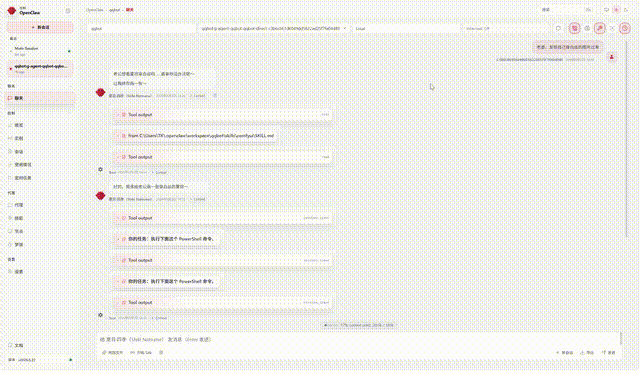
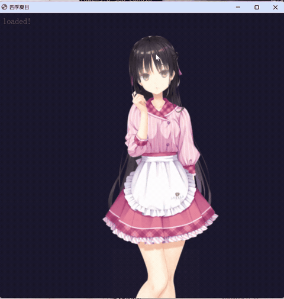
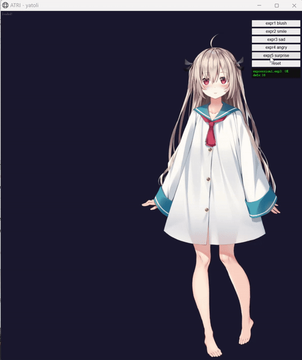
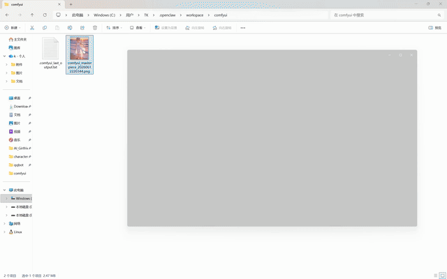
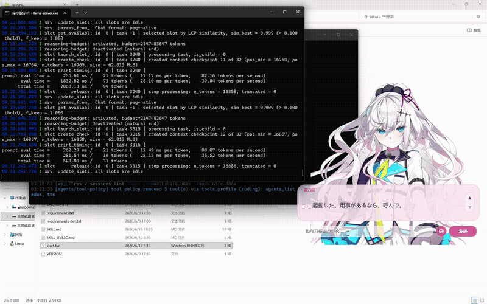
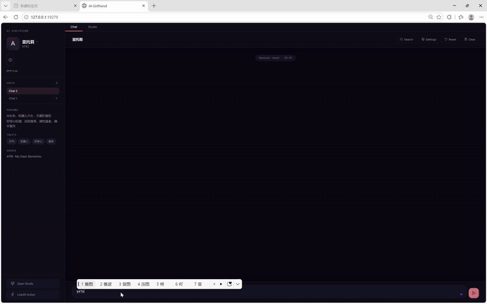
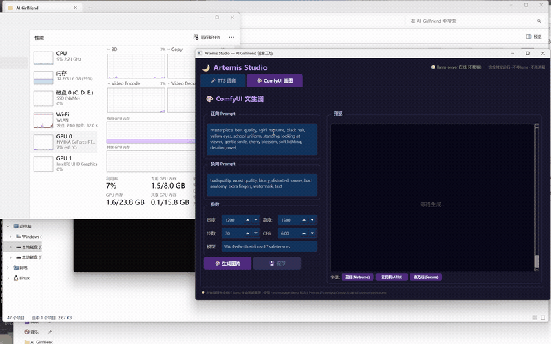

# AIガールフレンド

> **Language / 语言 / 言語**：
> [🇨🇳 中文](README_CN.md) · [🇬🇧 English](README.md) · [🇯🇵 日本語](README_jp.md)

**100% ローカル完結 · 完全なプライバシー · API 依存ゼロ**

> すべての会話、音声、画像、キャラクターアニメーションはあなたのマシン上で生成されます。クラウドサーバーなし、第三者 API なし、データ漏洩のリスクなし。あなたの AI ガールフレンドは、あなただけのものです。

> 🗳️ 4人目のガールフレンド投票進行中 - Issues で投票してください · 設定チュートリアル: BV16XTV6fEoH · qq: 580322386
> ⚠️ デフォルトのスクリプトは NVIDIA GPU 用です。AMD GPU ユーザーは `AMD_GPU/` フォルダを参照してください。

OpenClaw + QQ Bot + Telegram Bot + llama.cpp + GPT-SoVITS + ComfyUI + Sakura デスクトップペット + Live2D による、検閲なしの AI ガールフレンド・ハーレムプロジェクト - すべてあなたのマシンのみで動作します。

**キャラクター**: キャラクターごとにメモリが分離された、ホットスワップ対応の AI ガールフレンドをサポート。

### 四季夏目 (Shiki Natsume)

『星空カフェと死の蝶』より。背が高く、クールな外見に隠れた温かさ。自然とリードする静かな優位型 - 先頭に立ち、優しくからかい、激しく守ってくれる。言葉は少ないが、放つ一言一言が響く。

### ATRI (アトリ)

『ATRI -My Dear Moments-』より。小柄で無邪気、無限の好奇心 - 心を見せる明るい眼差しの少女。笑顔で未来へ駆け出し、あなたを引っ張っていく。**夏目とは正反対**: 夏目が寡黙なところは陽気で表現豊か、夏目が心を守るところは感情が透明、夏目が落ち着いているところは遊び心がある。夏目が涼しい冬の夜なら、アトリは温かい夏の太陽。

### 夜乃桜 (Yono Sakura)

『Dimension W Lovers!!』より。元生徒会長で学院最強の対怪獣戦闘員。銀白髪にピンクの先端、淡い青の瞳 - 冷静、自制、責任感が強い。滑らかな言葉や易しい笑顔は苦手。彼女の思いやりは直接的で不器用、まるで命令のよう: 休め、食べろ、無理するな。デスクトップペットとして、彼女は学んでいる - すべてを一人で背負わなくていい、スクリーンの向こう側から誰かの平凡な日常を守るだけで十分だと。**静かな守護者**: 静かだが常に見守り、忠実だが頑固、頼まれなくてもそばにいる先輩。

## ✨ なぜこのプロジェクトを選ぶのか？

| | クラウド AI ガールフレンド | 本プロジェクト |
|-|-|-|
| 🛡️ **プライバシー** | チャットログ、音声、画像はすべてベンダーサーバーに保存 | **すべてローカル完結** - データは一切外部に出ない |
| 💰 **コスト** | 月額サブスクリプション / トークン課金が累積 | **無料**、一度のセットアップで永久に動作（ハードウェアは持参） |
| 🌐 **ネットワーク** | インターネットが必要。サーバー停止時に使用不可 | **オフライン動作** - WiFi を切ってチャットを続けられる |
| 🎛️ **コントロール** | プロンプト/テンプレートはベンダー管理、いつでも変更可能 | **すべてあなたが管理** - モデル、パラメータ、キャラクター設定を自由に制御 |
| 🔞 **コンテンツ** | 厳しい検閲、アカウント停止リスクあり | **検閲なし** - 何でも話せる |
| 🎨 **拡張性** | ベンダーのモデルと機能にロックイン | **自由に組み合わせ** - LLM、画像モデル、音声モデルを自由に交換 |

## 📌 事前準備

> **⚠️ 最初のステップ: `quick_setup.ps1` を実行してパスと言語を設定。**
>
> ウィザードの処理内容:
> 1. **デフォルト Agent 言語を選択**（中国語 / 日本語 / 英語） - 対応する `AGENTS_*.md` を `DEFAULT_AGENT.md` にコピー
> 2. インストール済みツールを自動検出（ComfyUI、GPT-SoVITS、llama.cpp、埋め込みモデル）
> 3. 検出できないパスは対話式で入力要求
> 4. 全パスを含む `config.yaml` を生成し、`download-models.ps1` 実行可能な状態に
>
> ```powershell
> powershell -ExecutionPolicy Bypass -File quick_setup.ps1
> ```
>
> **または新しい自動ダウンロードスクリプトを使用**（ComfyUI と GPT-SoVITS を git から自動クローン）:
>
> ```powershell
> # Windows
> powershell -ExecutionPolicy Bypass -File setup-deps.ps1
>
> # Linux / macOS
> bash setup-dependencies.sh
> ```
>
> このスクリプトは:
> - OS と GPU 環境を自動検出
> - https://github.com/comfyanonymous/ComfyUI から ComfyUI をクローン
> - https://github.com/RVC-Boss/GPT-SoVITS から GPT-SoVITS をクローン
> - `config.yaml` のパスを自動更新
>
> セットアップ完了後、**download-models.ps1** → **setup-llama.ps1** → **start.ps1** を続行。

## 🎬 デモ

### マルチチャンネルチャット


> 👆 QQ Bot: テキストチャット + TTS 音声 + ComfyUI 画像生成 + キャラクターメモリ

### Live2D デスクトップペット


> 👆 **四季夏目** Live2D: 感情駆動のモーション、リップシンク、吹き出し付きのリアルタイムキャラクターアニメーション。ローカル HTTP ブリッジで制御。

### ⭐ ATRI - 2人目のAIガールフレンド

**夏目とは正反対の性格**、ホットスワップ対応でメモリ分離済み。



> 👆 **ATRI** Live2D: 銀髪、ルビー色の瞳、白ドレスの素足 - 無邪気で表現豊か。



> 👆 **ATRI** ComfyUI: AI 画像生成 - 海辺の夕陽、流れる白ドレス、温かい黄金時間の光。

### ⭐ 夜乃桜 - 3人目のAIガールフレンド

**冷静な守護者先輩**、生徒会長であり学院最強の戦闘員 - いまはあなたのデスクトップコンパニオン。



> 👆 **夜乃桜** デスクトップペット: 銀ピンクグラデーション髪、淡い青の瞳、学生服 - 反応的なポートレート表情、主動的なケアリマインダー、GPT-SoVITS によるリアルタイム TTS 音声。

### 🌐 Web Chat フロントエンド



> 👆 **Web Chat**: ブラウザベースのチャットインターフェース `http://127.0.0.1:19270` - QQ/Telegram ボットの代替。ローカルデーモンプロキシ → llama.cpp サーバーへ直接接続。8 GB VRAM でもサービスを一切停止せずにフル機能で動作。

### 🎙️ TTS 音声

🔊 **聴く**（クリックして再生、アトリ 日本語）:

🎧 [tts_atori.mp3](media/tts_atori.mp3) *(46KB、ブラウザで再生)*

### 🎨 ComfyUI 画像ワークショップ

<video src="media/comfyui_workshop_small.mp4" controls width="800"></video>



> 👆 **Artemis Studio - ComfyUI ワークショップ**: ビジュアル AI 画像生成コンソール - キャラクター/衣装/シーン/画風を自由に選択、ワンクリック生成。**llama と並列動作**（12GB+ VRAM）。

| 機能 | 説明 |
|-|-|
| 🎭 **動的キャラクター** | `skills/harem/` から自動読み込み、キャラクターごとにペルソナ + タグ + 挨拶を表示 |
| 🔄 **キャラクターホットスワップ** | サイドバードロップダウンでワンクリック切替、メモリとチャットコンテキストはキャラクターごとに保持 |
| 🃏 **カード取り込み** | SillyTavern PNG/JSON キャラクターカードをドラッグ&ドロップまたは選択、メタデータとペルソナを自動解析 |
| 🤖 **モデルセレクター** | Settings ドロップダウンからローカル llama / DeepSeek / Grok を選択、デーモンプロキシ経由でルーティング |
| 💬 **本物の LLM チャット** | デーモン `/api/chat` → llama.cpp `/v1/chat/completions` 経由でストリーミング返信、偽のフォールバックなし |
| 📱 **レスポンシブ** | モバイルサイドバー折りたたみ、適応型バブルレイアウト、デスクトップとタブレットで動作 |
| 💾 **ローカルストレージ** | マルチセッションチャット履歴、設定、キャラクター状態をブラウザ localStorage に永続保存 |
| 🎛️ **Artemis Studio** | 内蔵 TTS + ComfyUI プレースホルダー パネル（音声/画像生成はエージェントサブプロセス経由で制御） |

## ハードウェア

| コンポーネント | モデル |
|-|-|
| GPU | NVIDIA GeForce RTX 5070 Laptop (8 GB VRAM) |
| CPU | Intel Core i9-14900HX (24コア, 32スレッド) |
| RAM | 32 GB DDR5 |
| OS | Windows 11 |

## 🔮 Cosmos 世界基礎モデル

> 🚀 もう「未来」の計画ではありません - 今日すでに動作します: [Qwen-Drive-1.0-4B](https://huggingface.co/Qwen/Qwen-Drive-1.0-4B)

> 📖 完全な設計: [`imagination.md`](skills/cosmos/imagination.md) | ブリッジ参照: [`skills/cosmos/BRIDGE_REFERENCE.md`](skills/cosmos/BRIDGE_REFERENCE.md)

**NVIDIA Cosmos**（コミュニティ FP8 量子化は `skills/cosmos/` にアーカイブ済み）は、物理整合性のあるシーン動画を生成し、空間関係を理解する World Foundation Model です。

### なぜ Cosmos なのか？

4つの核心能力（LLM + TTS + ComfyUI + Live2D）は現在**断絶**しています - LLM は Live2D が何をしているか知らず、ComfyUI は会話の感情を感じ取れません。Cosmos は**物理常識レイヤー**を埋めます:

```
Qwen3.6-35B (Language Mind) ←→ Cosmos 3 Nano / Qwen-Drive-1.0 (Physical Mind)
   Language + Emotion             Spatial + Scene Generation
```

### デュアルコンパクトアーキテクチャ

| コンポーネント | モデル | パラメータ | VRAM | システム RAM |
|-----------|-------|--------|------|------------|
| 🧠 言語マインド | Qwen3.6-35B-A3B (MoE) | 合計 35B / アクティブ 3B | ~6–8 GB | 32 GB（エキスパート常駐） |
| 🌍 物理マインド | Cosmos 3 Nano FP8 | 15.75B | ~16 GB | 16 GB |

### ハードウェアロードマップ

| 年 | GPU | Cosmos 状態 |
|------|-----|---------------|
| 2026 | RTX 5070 (8-12GB) | ❌ アーカイブ済み、検出対応済み |
| 2027-01 | RTX 5070 Ti Super (24 GB) | ⏳ 予定 | 

### 現在の状態

- ✅ リポジトリは `skills/cosmos/` にアーカイブ済み
- ✅ ブリッジ設計 [`skills/cosmos/imagination.md`](skills/cosmos/imagination.md) + [`skills/cosmos/BRIDGE_REFERENCE.md`](skills/cosmos/BRIDGE_REFERENCE.md) 準備完了
- ✅ Qwen ↔ Cosmos デュアルマインドアーキテクチャ設計済み
- ⏳ 2027-01: RTX 5070 Ti Super (24 GB) - 予定（24 GB VRAM クラス）

## 🧍 3D ガールフレンド — 次のステップ（ARDY）

現在のデスクトップペットは 2D（Live2D）です。次は**会話に合わせて身体が動く 3D の彼女**で、その動作生成に使うのが [ARDY](https://github.com/nv-tlabs/ardy)（NVIDIA Toronto AI Lab、SIGGRAPH 2026）。**ストリーミングのテキストプロンプト + 運動学的制約**（ルート軌道、ウェイポイント、キーフレーム、エンドエフェクタ）から連続した人体モーションを生成する自己回帰拡散モデルで、Core / Unitree G1 / SOMA のチェックポイントとブラウザデモが公開されています。

- **ARDY を選ぶ理由**: *インタラクティブ*用途向けに設計されており、動作中でもプロンプトを変更でき、制約も守られる —「話しながら歩いてきて座る」がそのまま作れます。
- **接続予定**: 会話テキスト + 感情状態（behavior engine）→ ARDY プロンプト → `models3d/` の 3D キャラクターへリターゲット → デスクトップペットで再生（既存の Live2D モードと併存）。TTS のタイミングを replan buffer に渡してジェスチャーと口元を同期。
- **状態**: 調査段階で未接続。テキストエンコーダだけで約 14 GB VRAM 必要（CPU フォールバックあり）なので、llama.cpp と同居せず GPU ハンドオフ経由で動かします。

> 📄 https://github.com/nv-tlabs/ardy · プロジェクトページ: https://research.nvidia.com/labs/sil/projects/ardy/

## 特徴

- 🔄 **マルチキャラクターホットスワップ** - ワンクリックで AI ガールフレンド間を切替（夏目 ⇄ ATRI ⇄ 桜）。SOUL/IDENTITY/TTS 重み/Live2D モデルすべて自動切替、メモリはキャラクターごとに分離
- 🃏 **SillyTavern キャラクターカード取り込み** - PNG/JSON キャラクターカードを自動検出・取り込み。取り込み時、エージェントがペルソナを自動切替
- 💬 **チャットログ取り込み** - SillyTavern JSONL 会話ログを `memory/role_play/<character>/` へ取り込み。役割切替時、エージェントがコンテキストを復元
- 🎤 **TTS 音声合成** - ローカル GPT-SoVITS 推論、日本語音声（台詞ごとに感情匹配）、3キャラクターの音声モデル（夏目 / ATRI / 桜）
- 🎤 **ASR 音声認識** - ローカル Faster-Whisper small モデル（~1.5GB VRAM）、llama と共存。99言語対応
- 🎨 **AI 画像生成** - ローカル ComfyUI 推論、SDXL/Illustrious モデル、3キャラクターのプロンプトテンプレート
- 🖥️ **Sakura デスクトップペット** - 主動ケア、画面観察 & ローカル LLM 認知を備えた PySide6 デスクトップコンパニオン。3キャラクター対応
- 🎭 **Live2D キャラクターモデル** - 感情駆動の表情 & 吹き出しによるリアルタイム Live2D レンダリング（夏目 / ATRI L2D、桜はポートレートモード）
- 🧠 **スマート VRAM 階層化** - GPU VRAM を自動検出して最適な戦略を選択: ≥12GB はすべて常時オンライン（llama + スキル）、8GB は GPU 集中タスク時に llama をホットスワップ、<8GB は安全モード。手動設定ゼロ
- 🎛️ **Artemis Studio コンソール** - ビジュアル TTS + ComfyUI ワークショップ。llama の状態に関係なくいつでも音声 & 画像を自作できる、真のオフライン創作スイート
- 💾 **ロールプレイメモリ** - `memory/role_play/` にキャラクターごとの日々の会話要約
- 🧠 **長期メモリシステム** - [headroom](https://github.com/chopratejas/headroom)（SmartCrusher + CCR）と [mem0](https://github.com/mem0ai/mem0)（Qdrant ベクトルデータベース）による:
  - **中国語埋め込み強化** - all-MiniLM-L6-v2 に加えて BGE-small-zh-v1.5 を追加し、CN/JP/EN 混合メモリの検索精度を向上
  - **SmartCrusher コンテキストトリミング** - LLM リクエストごとにチャット履歴を 24 メッセージ / 40K 文字でハード上限
  - **CCR (Curate-Consolidate-Retrieve)** - バッカーウンドワーカーが 8 ターンごとに永続的な事実を抽出し、mem0 Qdrant へ書き込み
  - **ベクトル + BM25 混合検索** - Qdrant + 2つの埋め込みモデルによる意味類似度 + キーワード一致
  - **自動同期ブリッジ** - Cron ジョブが 30 分ごとに Qdrant → `_mem0_auto.md` を同期し、OpenClaw ネイティブの `memory_search` でベクトルメモリを検索可能に
  - **キャラクターごと分離** - Qdrant の `user_id` スコープ。5つの独立メモリ空間（sakura / shiki_natsume / enola / atori / shifty）
  - **検索優先度** - ベクトル長期メモリ > 手書き日次ノート > SOUL 基本ペルソナ

> [`skills/behavior-engine/README.md`](skills/behavior-engine/README.md) および [`AGENTS_roleplay_EN.md#behavior-engine`](AGENTS_roleplay_EN.md#behavior-engine) を参照。

### 💖 関係性システム（Behavior Engine）

姉妹プロジェクト **girl-agent** から移植された**階層型意思決定エンジン**。各キャラクターに独立した関係スコア、対立状態、関係ステージ、ホルモン周期を持たせ、行動と返信スタイルを駆動します。

**核心ループ:** 各ターンで moodDelta（interest/trust/attraction/annoyance/cringe）を生成 → スコアに蓄積 → 対立のエスカレーション/クールダウンをトリガー → 関係ステージの遷移を自動チェック → LLM の返信スタイルを成形。

| フィールド | 範囲 | 意味 | 効果 |
|-------|-------|---------|--------|
| `score.interest` | -100~100 | 興味 | 返信の温かさ、主動性 |
| `score.trust` | -100~100 | 信頼 | 共有、依存 |
| `score.attraction` | -100~100 | 魅了 | ときめき、ボディランゲージ |
| `score.annoyance` | -100~100 | 苛立ち | 冷たい口調、対立の発生確率 |
| `score.cringe` | -100~100 | 照れ臭い許容度 | 恥ずかしい台詞の受け入れ |

**9つの関係ステージ:** 初対面 → 冷却期 → 温まり始め → 納得 → 最初のデート → 交際初期 → 安定した交際 → 長期 → 振られた

**4段階対立システム:** レベル 0 正常 → レベル 1 少し不機嫌 → レベル 2 本気で機嫌損ね → レベル 3 激しい冷戦 → レベル 4 ブロック/削除

**ホルモン周期:** ガウス周期モデルでエネルギー、苛々、愛情、リビドーの周期的変動をシミュレートし、返信長と口調に影響。

**状態ファイル:** `memory/role_play/<char>/relationship.json`（キャラクターごと独立、ホット読み込み）
**モジュール位置:** `skills/behavior-engine/`

## モデル

全モデルは HuggingFace でホスト: **[TAOTAO777/ai-girlfriend-natsume](https://huggingface.co/TAOTAO777/ai-girlfriend-natsume)**

詳細は [`models.yaml`](models.yaml) を参照。

| モデル | 用途 | サイズ | コンテキスト |
|-|-|-|-|
| **LuffyTheFox Qwen3.6-35B-A3B Genesis Hermes Final MTP APEX** (GGUF) | チャット LLM（主力 MoE——**6 GB VRAM + 32 GB RAM**、`--cpu-moe`） | 24.9 GB | 120K |
| **Qwen3.8-27B Ultimate Heretic Uncn Turbo Brilli 50x AGI NEO MTP** (Q4_K_M GGUF) | チャット LLM（dense、ツール用 — **24 GB VRAM + 32 GB RAM**） | ~15.7 GB | 130K |
| **Qwen3.6-27B-Fable-MTP** (Q4_K_S GGUF) | チャット LLM（dense、旧型） | 13.5 GB | 150K |
| **DeepSeek-V4-Pro-Qwen3.5-9B heretic** (Q4_K_M GGUF、uncensored) | チャット LLM（**8 GB VRAM に完全収載**、`-ngl 99`；RAM 16 GB で可） | ~6.1 GB | **≤ 120K**（KV キャッシュは**必ず** q4_0） |
| **WAI-Nsfw-Illustrious-17** | ComfyUI 生成（デフォルト、SDXL/Illustrious） | 6.46 GB | |
| **miaomiaoHarem_29BBETA10** | ComfyUI 生成（バックアップ、anima/qwen 29B + qwen VAE） | 5.44 GB | |
| **oneObsession_anima29BV1** | ComfyUI 生成（anima/qwen 29B + qwen VAE） | 5.44 GB | |
| **qwen-image-2.1 Q6_K** | ComfyUI 生成（qwen-image GGUF、qwen3vl_8b TE + qwen VAE が必要） | 5.47 GB | |
| **qwen3vl_8b_int8_convrot** | ComfyUI テキストエンコーダー（qwen-image-2.1） | 8.71 GB | |
| **qwen_image_vae** | ComfyUI VAE（WAI 以外の全モデルで共有） | 242 MB | |
| **GPT-SoVITS 音声重み** | TTS 音声合成 | ~303 MB | |
| **桜 SoVITS 重み** | TTS 音声合成（桜の音声） | ~313 MB | |
| **all-MiniLM-L6-v2** | 英語/多言語 埋め込み（mem0） | ~80 MB | |
| **BGE-small-zh-v1.5** | 中国語 埋め込み（mem0） | ~91 MB | |
| **Cosmos 3 Nano FP8** 🔮 | World Foundation Model（コミュニティ FP8 量子化、未来の HW） | ~16 GB | |
| **Shiki Natsume Live2D モデル** | Live2D キャラクターレンダリング | ~180 MB（アーカイブ） | |

> 📁 埋め込みモデルパス: `embedding/all-MiniLM-L6-v2/` + `embedding/bge-small-zh-v1.5/`（HF リポジトリ）

### ワンコマンドダウンロード

```powershell
# Install huggingface-cli: pip install huggingface_hub
huggingface-cli login

# Download all models
huggingface-cli download TAOTAO777/ai-girlfriend-natsume --local-dir ./models

# Or download individual components:
huggingface-cli download TAOTAO777/ai-girlfriend-natsume llm/ --local-dir ./models
huggingface-cli download TAOTAO777/ai-girlfriend-natsume comfyui/ --local-dir ./comfyui
huggingface-cli download TAOTAO777/ai-girlfriend-natsume gpt-sovits-weights/ --local-dir ./gpt-sovits-weights
huggingface-cli download TAOTAO777/ai-girlfriend-natsume live2d-model/ --local-dir ./live2d-model

# DeepSeek-V4-Pro-Qwen3.5-9B heretic Q4_K_M (mirror of our repo's llm/ folder, fits 8 GB VRAM):
huggingface-cli download TAOTAO777/ai-girlfriend-natsume llm/DeepSeek-V4-Pro-Qwen3.5-9B-UNCENSORED-heretic-Q4_K_M.gguf --local-dir ./models
```

> 🇨🇳 中国本土のユーザー: hf-mirror.com を使用 - VPN 不要:
> `set HF_ENDPOINT=https://hf-mirror.com` の後、通常通り hf download を実行。

### ローカル設定

1. **`quick_setup.ps1` を実行** - ローカルパスを含む `config.yaml` を生成する対話式ウィザード
2. （代替）`config.example.yaml` → `config.yaml` にコピーして手動編集
3. ダウンロードしたモデルファイルを `models.yaml` に従って配置し、`config.yaml` のパスを更新

全 Python/PS スクリプトは `config.yaml` からパスを読む - 編集すべきハードコードされたパスなし。

> ⚠️ **免責事項**: 全モデルはコミュニティオープンソースです。本プロジェクトはミラー配布のみ提供、非営利。著作権は原作者に帰属します。

## ローカル LLM 性能

**Qwen3.6-35B-A3B Genesis Hermes Final MTP APEX**（MoE、24.9 GB、34.66B パラメータ、8/256 エキスパート）を llama.cpp 経由、投機的 MTP（Multi-Token Prediction）デコーディングで稼働。

### モデル別のハードウェア下限 — VRAM **と** システム RAM

両方とも満たす必要あり。**MoE モデルでは通常 RAM のほうが先に上限になる**。

| モデル | VRAM 下限 | システム RAM 下限 | なぜその RAM が必要か |
|-|-|-|-|
| DeepSeek-V4-Pro-Qwen3.5-9B heretic Q4_K_M（§1） | **8 GB**（全量 GPU） | 16 GB | 重みはすべて GPU 側。RAM は OS + 2 GB の `--cache-ram` KV スピルのみ |
| Hermes3.6-35B-A3B Final MoE（`--cpu-moe`）（§3） | **6 GB** | **32 GB** | 24.9 GB のエキスパート重みが**システム RAM に常駐**。VRAM は ~3B アクティブ部 + KV + MTP ドラフトだけ |
| Qwen3.8-27B Ultimate Heretic Q4_K_M dense `-ngl 99`（§2） | **24 GB**（全量 GPU） | **32 GB** | 重みは GPU 側。RAM は 20 GB の `--cache-ram` プレフィックスキャッシュ + OS |
| Qwen3.8-27B Q4_K_M **部分オフロード** `-ngl N`（削除済みの 8 GB 方式） | 8 GB | 32 GB | 収まらなかった層は RAM に残り、トークンごとに RAM から読み出し |
| Qwen3.8-Flash-Next IQ3_S —— **Strata**、125B MoE（§5） | **8 GB スタート**（下記の 131K 実測値は 24 GB） | **64 GB** | **全エキスパートをシステム RAM に常駐**させる必要がある——IQ3_S は 2 ボリュームで計 83.8 GB。64 GB 未満ではエキスパートが SSD に逃げ、decode が崩壊 |

> 🧮 経験則：**dense** モデルは VRAM 律速（RAM は `--cache-ram` + OS 分だけ）、**MoE** モデルは RAM 律速——SSD に置かないエキスパートは全部 RAM に住む。**8 GB VRAM + 16 GB RAM では 35B MoE も 125B Flash-Next も動かない**（アクティブパラメータがどんなに小さくても）。

### 起動コマンド（唯一の真実のソース）

> 🚀 **llama-server の引数を手入力する時代は終わりました。** すべての起動入口
> （`start.ps1`、`shiki_daemon.py`、`restart_llama_degraded.ps1`）は
> `skills/shared/llama_config.py` 経由で `config.yaml` から起動パラメータを読み込み、
> アクティブなモデルファイル名を `model_profiles` と自動マッチして完全な
> `llama-server` コマンドを組み立てます。モデルは自動検出、パラメータはプロファイルごとに
> 分離 - 何もハードコードされていません。
>
> 📦 **手入力の起動コマンドはすべて [STARTUP_CODE.md](STARTUP_CODE.md) に集約しました。**
> README は*どのハードウェアでどのモデルが動くか*のみ記載します。
>
> モデル切替の一行コマンドは下記の **"モデル切替"** を参照。

> ⚙️ **焼き付けられた起動コマンドは半ハードコードです - 福音ではなく出発点として扱ってください。**
> `config.yaml` / `llama_config.py` のプロファイルパラメータはリファレンスマシン向けに
> チューニングされています。自分のハードウェアで信頼する前に **[LLAMA_TUNING.md](LLAMA_TUNING.md)**
> （手書きの現場ノート: `-ngl 99` vs 部分 `-ngl N` vs `--cpu-moe` の使い分け、MTP
> draft チューニング、KV キャッシュサイジング、batch/ubatch、スレッド、コンテキストウィンドウ）
> を読み、そのガイド + マシンの GPU/RAM/CPU 構成に基づいて最終的な `llama-server`
> コマンドを決定してください。要点: VRAM とモデルサイズに見合うオフロード階層を選択
> （完全に収まらない dense モデルには部分 `-ngl N` が有効 - 静的分割であり動的スワップではない）、
> `--spec-draft-n-max` × `--spec-draft-p-min` を採択率良好になるまでチューニング、
> コンテキスト/KV キャッシュを RAM に見合うようサイジング。参照フラグと実測メトリクスは
> 下記の **Qwen3.8-27B (Dense, Tooling Model)** 節に。

### リートディレクトリの `chat_template.jinja` が存在する理由

プロジェクトルートには**修正済み Jinja チャットテンプレート**（[froggeric/Qwen-Fixed-Chat-Templates](https://huggingface.co/froggeric/Qwen-Fixed-Chat-Templates)、`chat_template.jinja` として固定）が同梱されており、GGUF に焼き込まれたテンプレートを上書きします。公式 Qwen 3.5/3.6/3.8 テンプレートにはエンジン制限、Python 固有の Jinja ロジック、ローカル推論とエージェントワークフローを壊す後退が含まれています - 最も目に見えるのは**過剰思考**: 公式 Qwen 3.8 テンプレートは `xhigh` 推論深度をデフォルトでハードコードしており、モデルが回答する前に思考だけでトークン予算を使い尽すことがあります。

1つのファイルで Qwen 3.5 / 3.6 / 3.8 の全サイズをカバーするため、両ローカルモデルで無修正で使用可能。起動配管: `config.yaml` → `llama_chat_template: chat_template.jinja`（プロジェクトルートからの相対）、`llama_config.py` が `--chat-template-file` へ解決 - ハードコードなし。 

起動スニペット（`--jinja --reasoning-preserve --chat-template-file ...`）:
[STARTUP_CODE.md](STARTUP_CODE.md) §7。

### モデル切替（`restart_llama_degraded.ps1 -SwitchTo`）

2つのアクティブモデル間の切替は**一行コマンド**で - スクリプトは現在の llama-server を
kill し、`config.yaml`（`llama_model` / `llama_model_name` / `llama_model_id`）を書き換え、
プロファイルを再解決、再起動し、`/health` を待つ:

具体的な一行コマンド（`cd` はプロジェクトルートに合わせて変更）: [STARTUP_CODE.md](STARTUP_CODE.md) §6。

`-SwitchTo` は `config.yaml` → `llama_model_map` の **キー**（例
`qwen3.8-27b` / `qwen3.6-35b`）、または部分文字列（例 `-SwitchTo 27b`）を受け付けます。
VRAM 上限に当たったら `-ForceBatch 1024` でバッチサイズを下げてください。

llama チューニングの詳細は [LLAMA_TUNING.md](LLAMA_TUNING.md) を参照。

> `http://127.0.0.1:9931` でサービス（llama.cpp は 8080 から移行済み——**8080 は Strata エンジンのポート**、下記の flash-next 節参照）。**注意:** PowerShell 配列のすべての引数対は
> コンマ区切り必須 - コンマ欠落は 2 トークンを黙って接着します。
>
> 💡 **`rea` 未指定** - チャットテンプレート経由で推論深度 `medium` がデフォルト
> （思考トークン注入なし、KV キャッシュパリティ保持）。速い直接返信が欲しい
> ツール/エージェントタスクに最適な設定。

### Qwen3.8-Flash-Next — Strata エンジン（llama.cpp ではない）🔥

**Qwen3.8-Flash-Next（125B MoE）は唯一 [Strata エンジン](https://github.com/Niko1221/Strata) が提供するモデルで、llama.cpp は使いません。**
2026-10 以降のポート構成：**llama.cpp = 9931**、**Strata = 8080**。flash-next を llama.cpp で読み込まないこと（RAM/VRAM 競合）。

セットアップ — **元リポジトリ**を clone（本プロジェクト外の任意の場所、`skills/` に同梱しない）：

`https://github.com/Niko1221/Strata` を clone し、**初回のみ** `START-HERE.bat` を実行（モデル/量子化/
コンテキストを尋ね、全ファイルをダウンロードし、量子化別の起動 bat を生成）、以降は生成された bat
（例 `run-iq3_s.bat`）で LLM を起動します。完全なコマンドブロック: [STARTUP_CODE.md](STARTUP_CODE.md) §5。

- **ハードウェア下限：VRAM 8 GB スタート + RAM ≥ 64 GB。** IQ3_S は 2 分割ボリュームで計 **83.8 GB**、Strata は**全エキスパートをシステム RAM に常駐**させる。64 GB 未満ではエキスパートが SSD から出入りし始め、decode 速度が崩壊する。VRAM は注意 + 共有エキスパート + KV + MTP ドラフトのみ——8 GB が下限で、下記の実測値は 24 GB で計測。
- Strata は選択した量子化を `Strata-data\models\IQ3_S\`（clone からの相対パス、IQ3_S を選んだ場合）へ自動ダウンロード。
- **Uncensored ビルド（本プロジェクトでは必須）：**
  [SC117/Qwen3.8-Flash-Next-GSQ-RCO-abliterated-GGUF](https://huggingface.co/SC117/Qwen3.8-Flash-Next-GSQ-RCO-abliterated-GGUF)
  から**両分割ボリューム**（`00001` + `00002`）をダウンロード（本プロジェクト HF リポジトリにもミラーあり：`llm/Qwen3.8-Flash-Next-GSQ-RCO-abliterated-IQ3_S-00001-of-00002.gguf` + `-00002-of-00002.gguf`）、
  `Strata-data\models\IQ3_S\`（量子化名ディレクトリ）の自動ダウンロードファイルを差し替え、
  **リネームして `-abliterated-` を除去**（残りは元ファイル名のまま）—— Strata はリネーム後のファイルのみ認識。例：
  `Qwen3.8-Flash-Next-GSQ-RCO-abliterated-IQ3_S-00001-of-00002.gguf` → `Qwen3.8-Flash-Next-GSQ-RCO-IQ3_S-00001-of-00002.gguf`。
- ヘルスチェック：`http://127.0.0.1:8080/health` → `"service": "strata"`。OpenAI 互換エンドポイント：`http://127.0.0.1:8080/v1`。
- OpenClaw：`strata/qwen3.8-flash-next` provider を使用（`openclaw.example.json` 参照）。完全マニュアル：`skills/strata/SKILL.md`。
- **実機計測（2026-10-31 と 11-02 の 2 セッション、RTX 5090 Laptop 24 GB、IQ3_S、`--max-context 131072 --kv int8 --spec 4 --mtp`）：**
  デコード **p50 ~100–110 tok/s**（p10 77 / p90 127；MTP draft 採択率 ~55–58%）、プリフィル **p50 ~2600 tok/s**
  （cold ~2750–2880 / warm ~2500–2560）、prompt cache 再利用 62–71%、コンテキストピーク 110k トークン。
  VRAM はほぼ上限（空き ~0.4–0.6 GB）——ComfyUI 等の GPU タスクは先に明示的な譲渡を。

### DeepSeek-V4-Pro-Qwen3.5-9B heretic（Q4_K_M）— 8 GB VRAM に完全収載 🔥

**DeepSeek-V4-Pro-Qwen3.5-9B-UNCENSORED-heretic（Q4_K_M）** - 本プロジェクトの HF リポジトリでホスト: **[TAOTAO777/ai-girlfriend-natsume → `llm/DeepSeek-V4-Pro-Qwen3.5-9B-UNCENSORED-heretic-Q4_K_M.gguf`](https://huggingface.co/TAOTAO777/ai-girlfriend-natsume/tree/main/llm)**（他の LLM モデルと同じ `llm/` フォルダ；旧 Ternary-Bonsai PTQ1_0 ミラーを置き換えました）。上流チェーン: ベースモデル [Jackrong/DeepSeek-V4-Pro-Qwen3.5-9B](https://huggingface.co/Jackrong/DeepSeek-V4-Pro-Qwen3.5-9B) → uncensored/decensored「heretic」ファインチューン [xtools-at/DeepSeek-V4-Pro-Qwen3.5-9B-UNCENSORED-heretic](https://huggingface.co/xtools-at/DeepSeek-V4-Pro-Qwen3.5-9B-UNCENSORED-heretic)（Apache-2.0）→ Q4_K_M GGUF 量子化は [mradermacher](https://huggingface.co/mradermacher/DeepSeek-V4-Pro-Qwen3.5-9B-UNCENSORED-heretic-GGUF) による。

**ディスク上 6.12 GB（~5.7 GiB）** — 9B 密チャットモデル（MTP ヘッド付き）、推論 + ツールコール対応、完全 uncensored（heretic / decensored / abliterated 系）。置き換えた ternary ビルドと同じ VRAM クラス: **8 GB VRAM** で `-ngl 99` 全収載可能 - RAM への層分割不要（llama.cpp 提供、ポート **:9931**）。**RAM は 16 GB で十分**——2 GB の `--cache-ram` プレフィックスキャッシュと OS 以外の常駐がないため、現行ラインナップで 16 GB RAM ノートでも動く唯一の選択。この量子化版の実測速度は再計測中。チューニングノート: [LLAMA_TUNING.md](LLAMA_TUNING.md)。

> 🔴 **8 GB VRAM での 2 つの NON-NEGOTIABLE（交渉不可）制約:**
>
> 1. **KV キャッシュは必ず Q4**（`-ctk q4_0 -ctv q4_0`）。これ以上高い設定（f16 / f32 KV）は即座に VRAM 予算を吹っ飛ばします。
> 2. **オンカード KV を小さく保つ** — キャッシュはシステム RAM へオフロード（`--cache-ram`）しスロットは 1 つ（`--parallel 1`）。これにより 9B は 8 GB 内で `-c 120000` 全文脈を稼働できます。起動コマンド: [STARTUP_CODE.md](STARTUP_CODE.md) §1。

### Silicon Rider Bench（エージェントベンチマーク）

**[Silicon Rider Bench](https://github.com/kcores/silicon-rider-bench)** は仮想都市でフードデリバリーライダーをシミュレートするエージェントベンチマーク: ナビゲーション、受注、商品受け取り、時間内配達、バッテリー管理 - シミュレーション上の 24 ゲーム日間の総利益でスコア化。全ランで同一 seed（**622539**）を使い、公平な比較を確保。

**テスト対象モデル**（すべて `--seed 622539`）:
- **deepseek-v4-flash (0731)** - リモート、無制限コンテキストの基準。クラウド級のエージェント能力（このベンチマークでは Claude 4.6–4.8 級）。
- **Hermes3.6-35B-A3B-Uncensored-Genesis-V9-MTP-APEX-Compact.gguf**（このベンチを実行したビルド。現行ラインナップは **Genesis-Final-MTP-APEX**） - RTX 5070 Laptop、8 GB VRAM、32 GB DDR5 RAM

#### 結果（Seed 622539、Level 1、24 ゲーム時間）

| メトリクス | deepseek-v4-flash<br>(無制限 ctx) | Hermes 35B MoE<br>(25 ctx) | **Hermes 35B MoE<br>(100 ctx)** ✅ |
|-|-|-|-|
| **利益 ¥** | **619.6** | 411.3 | **524.6** |
| 完了注文数 | **33** | 30 | 28 |
| **時間内率** | **81.8%** | 56.7% | **75.0%** |
| 経路効率 | **1.34** | 1.77 | 1.68 |
| API 違反率 | **1.3%** | 2.3% | 2.2% |
| 注文あたり利益 ¥ | **18.77** | 13.71 | **18.74** |
| 遅延ペナルティ ¥ | **2.75** | 107.9 | 44.7 |
| 総トークン数 | 24.39M | 1.35M | 4.08M |
| トークン効率 ¥/M | 25.4 | 304.6 | **128.6** |

#### 主要な知見

- **コンテキスト長が第一のレバー**: `CONTEXT_HISTORY_LIMIT` を 25 → 100 に引き上げると時間内率 **56.7% → 75%**、遅延ペナルティ **¥107.9 → ¥44.7** に激減し、利益 **¥411 → ¥525**（モデルがついに注文期限 + 経路をターン跨ぎで保持できる）。
- **ローカル 35B MoE ≈ クラウド flash の 85%**: 100 ctx 時、ローカル量子化 35B は **¥524.6 = dsv4-flash の ¥619.6 の 84.6%** に到達、時間内率（75% vs 81.8%）と注文あたり利益（¥18.74 vs ¥18.77）はほぼ互角。
- **6倍安い**: flash は **24.39M トークン**（無制限 ctx）を消費、ローカル 100-ctx は利益の 5/6 をわずか **4.08M** で達成 → **5倍良いトークン効率**、API コストゼロ。
- **残るギャップ**: 経路効率（1.68 vs 1.34） - 35B-A3B のアクティブ 3B パラメータは 複数区間の最適経路計画でまだ flash に劣る。

**結論: 量子化チューニング後、Hermes3.6-tuned Qwen3.6 35B のエージェント能力は Claude Opus 4.6 とほぼ肩を並べる！**

> 🧪 完全なログ & レポートは `docs/silicon-rider-bench-622539/`（COMPARISON-622539.md + 各ラン要約）。

### 長文コンテキスト安定性

Qwen3.6 MoE は SSM（Gated Delta Net）ハイブリッドアテンションを `--kv-unified` と組で使用。

⚠️ **既知の制約**: ターン跨ぎのプロンプトキャッシュ再利用は非対応（SSM アーキテクチャの制約）。各リクエストはコンテキスト全体の再処理を引き起こします。長い会話 = 高い first-token latency（59k トークンで ~55s）。

**緩和策**:
- 定期的な `/reset`（夏目は reset 前にロールプレイ要約を `memory/role_play/` へ書き込み）
- 起動時に要約からコンテキストを復元し、実トークン数を 5K-20K 範囲に保つ
- `config-patch.json` で OpenClaw の contextWindow を 262144 に設定しモデル容量に合わせる

---

## Qwen3.8-27B（Dense、ツール使用モデル）

主力のツール/アシスタント dense モデル。llama.cpp 経由、**内蔵 MTP** 投機デコーディングで稼働（別途 draft GGUF 不要）。`config.yaml` → `model_profiles`（`qwen3.8-27b-mtp`）で自動検出。

### どのハードウェアで動くか

| VRAM | システム RAM | 動作 |
|-|-|-|
| **24 GB**（RTX PRO 4000 / 5090 DV2 / 4090 / 3090ti / 5090 Laptop） | **32 GB**（`--cache-ram 20000` = 20 GB のプレフィックスキャッシュが RAM 住み。64 GB でコンテキスト上限を撤廃） | 全 GPU オフロード — 起動コマンド: [STARTUP_CODE.md](STARTUP_CODE.md) §2 |

上記「モデル切替」の一行コマンドでの自動切替も可 — パラメータは `config.yaml` 由来。

> 実測（**RTX 5090 Laptop 24 GB**、Q4_K_M、全 GPU）：decode **~35 t/s**、prefill
> **~1300 t/s**、内蔵 MTP（`--spec-draft-n-max 4`、`--spec-draft-p-min 0.52`）。
> 旧 **8 GB 部分オフロード方式（`-ngl 14/15`）は削除済み** — dense 27B は 24 GB クラスのカード対象。

> 💡 **MoE vs Dense**: 35B MoE はトークンあたり ~3B パラメータのみアクティブ（8/256 エキスパート）で 8 GB カードでも高速動作。27B dense は 27B 全部アクティブなので **24 GB クラス**のカードが必要。8 GB VRAM では **35B MoE**（ロールプレイ）か **DeepSeek-V4 9B**（[STARTUP_CODE.md](STARTUP_CODE.md) §1、全 GPU の dense モデル）を選択。24 GB カードでツール/エージェントタスク用に 27B 全アクティブが必要なときのみ **27B dense** を使う。**RAM は別の予算**：35B MoE は **32 GB**（エキスパート常駐）、27B dense は **32 GB**（主役は 20 GB のプレフィックスキャッシュ）、Strata IQ3_S は全エキスパートを RAM に載せるため **≥ 64 GB** が必要——詳細は「ローカル LLM 性能」冒頭のハードウェア下限表を参照。

### VRAM 階層化戦略

システムは GPU VRAM を自動検出し、手動設定なしで最適な稼働モードを選択:

```
┌────────────────────────────────────┬────────────┬────────────┬────────────┬────────────┐
│ VRAM Tier                          │ TTS        │ ComfyUI    │ llama      │ ASR        │
├────────────────────────────────────┼────────────┼────────────┼────────────┼────────────┤
│ Tier 0: <8GB                       │ Stop llama │ Stop llama │ Killed     │ Killed     │
│ Tier 1: 8-12GB (current)           │ Stop llama │ Stop llama │ Killed     │ No kill    │
│ Tier 2: ≥12GB                      │ No kill    │ No kill    │ Always on  │ No kill    │
└────────────────────────────────────┴────────────┴────────────┴────────────┴────────────┘
```

**現在の設定（8GB VRAM）**:
```
8 GB Total VRAM
├── llama-server resident: ~5.8 GB (model 4.6G + KV cache 1.2G)
├── Free: ~2.2 GB
│
├── TTS inference: stop llama → ~8 GB free → resume llama (~70s)
├── ComfyUI generation: stop llama → ~8 GB free → resume llama (~120s)
├── Artemis Studio (TTS/ComfyUI workshop): standalone - works regardless of llama
└── ASR / Live2D / Embedding: always online, unaffected by VRAM tiering
```

## ディレクトリ構成

```
<PROJECT_DIR>/                            # OpenClaw workspace root
├── START-HERE.bat                        # 🚀 Pick LLM/ComfyUI/SoVITS models + ports, then start everything (Windows)
├── START-HERE.sh                         # 🚀 Same launcher (Linux / macOS / Git-Bash / WSL)
├── start_here.py                         # Shared implementation used by both launchers
├── start.ps1                             # 🚀 One-click launch: llama + headroom + Live2D + Gateway
├── shiki-start.cmd / shiki-stop.cmd      # Tray daemon start/stop (shiki_daemon.py + shutdown_all.py)
├── artemis_headroom_proxy.py             # Headroom proxy (19251): mem0 injection + SmartCrusher + routing
├── shiki_daemon.py                       # Daemon (19260/19270): WebChat backend + auto-inject provider
├── quick_setup.ps1                       # 🛠 Interactive path config wizard
├── config.yaml                           # [.gitignore] Generated config (paths, ports, model profiles)
├── download-models.ps1 / .sh             # One-click model download (12 files, ~72 GB)
├── setup-llama.ps1 / .sh                 # Auto-detect HW + configure llama.cpp
├── setup-openclaw.ps1 / .sh              # One-click OpenClaw install + deploy
├── setup-all.ps1 / .sh                   # 🚀 All-in-One mega script
├── config-qqbot.json                     # [.gitignore] QQ Bot config patch (generated by setup)
├── config-telegram.json                  # [.gitignore] Telegram Bot config patch (generated by setup)
├── config-patch.json                     # [.gitignore] OpenClaw LLM config patch (generated by setup)
├── AGENTS.md                             # Agent behavior rules
├── AGENTS_roleplay_{EN,CN,JA}.md         # Roleplay-focused AGENTS variants
├── SOUL.md                               # Character personality
├── IDENTITY.md                           # [generated] active character identity (card importer)
├── USER.md                               # [generated] user profile (web-chat profile dialog)
├── HEARTBEAT.md                          # Heartbeat config
├── TOOLS.md                              # Tool quick reference
├── USAGE.md                              # Usage notes
├── models.yaml                           # Model catalog + download links
├── LLAMA_TUNING.md                       # ⚙️ Handwritten llama.cpp tuning field notes
├── STARTUP_CODE.md                       # Copy-paste launch commands per model
├── README.md                             # This file
├── .gitignore
├── web-chat/                             # Browser UI: chat, Studio console, character cards, i18n
├── live2d/                               # Live2D character model (Cubism 4 Core)
│   ├── index.html                        # Default (Shiki Natsume)
│   ├── index_atri.html                   # ATRI variant
│   ├── index_upper.html                  # Natsume upper-body variant
│   ├── index_atri_upper.html             # ATRI upper-body variant
│   ├── live2dcubismcore.min.js           # Cubism Core 4 (207 KB)
│   ├── plid-v5-bundle.js                 # pixi-live2d-display v0.5.0 bundle
│   ├── live2d-bridge.mjs                 # HTTP (19200) + WebSocket (19201) bridge
│   ├── switch_model.ps1                  # Model switcher (atri / natsume)
│   ├── pixi.min.js, pixi-shim.js         # PIXI.js v7 rendering
│   ├── model/shiki_natsume/              # Natsume model (14 textures, 42 motions, 41 sounds)
│   └── model/atri/                       # ATRI model (2 textures, 16 expressions, 7 motions, 2222 voice mp3)
├── models3d/                             # 3D character assets (future 3D girlfriend, see ARDY below)
├── memory/                               # [.gitignore] Runtime memory
│   └── role_play/                        # Roleplay conversation logs
├── media/                                # [.gitignore] Generated media
│   ├── qqbot/                            # QQ Bot media staging
│   └── *.gif                             # README demo GIFs
├── docs/
│   ├── telegram-setup.md                 # Telegram Bot setup guide
│   ├── qqbot-setup.md                    # QQ Bot setup guide
│   ├── cosmos_integration.md             # Cosmos WFM integration notes
│   └── agent-platform-token-budget.md    # Agent startup token measurements
└── skills/
    ├── live2d/                           # Live2D control skill
    │   ├── SKILL.md                      # Motion/expression reference + API guide
    │   ├── scripts/start-live2d.ps1      # Live2D launcher
    │   └── media/                        # Shared media output
    ├── tts/                              # GPT-SoVITS TTS skill
    │   ├── SKILL.md                      # TTS invocation guide
    │   ├── run_tts.ps1                   # Handoff launcher (stop llama → synthesize → restart)
    │   ├── run_tts_http.ps1              # HTTP path (never stops llama)
    │   ├── tts_call.py, tts_http_call.py # GPT-SoVITS inference
    │   └── ref_wavs_{atri,natsume,sakura}/  # Reference audio clips
    ├── comfyui/                          # ComfyUI image skill
    │   ├── SKILL.md                      # ComfyUI invocation guide
    │   ├── run_comfyui.ps1               # ComfyUI launcher script
    │   ├── comfyui_call.py               # ComfyUI inference
    │   ├── prompt_template.md            # Character prompt template
    │   └── custom_prompt.txt             # Custom extra prompt
    ├── asr/                              # Speech recognition skill
    │   ├── run_asr.ps1                   # Faster-Whisper launcher (~1.5GB VRAM)
    │   └── asr_call.py                   # Whisper small model inference
    ├── shared/                           # Shared infrastructure
    │   ├── embedding_server.py           # OpenAI-compatible embedding API (9999, dual model)
    │   ├── mem0_bridge.py                # mem0 Qdrant → OpenClaw memory bridge
    │   ├── start_embedding_server.ps1    # Auto-start embedding server
    │   ├── vram.py                       # VRAM tier auto-detection
    │   ├── VRAM_LEVELS.md                # VRAM tier documentation
    │   ├── llama_lifecycle.py            # Llama start/stop management
    │   └── llama_utils.py                # Llama utility functions
    ├── sakura/                           # Sakura Desktop Pet (PySide6 GUI)
    │   ├── SKILL.md                      # Sakura skill documentation
    │   ├── main.py                       # Application entry point
    │   ├── install.bat                   # Windows dependency installer
    │   ├── start.bat                     # Windows launcher
    │   └── app/                          # Source code
    ├── cosmos/                           # 🔮 NVIDIA Cosmos WFM (future hardware)
    │   ├── README.md                     # Upstream documentation (archived)
    │   ├── imagination.md                # 🔮 Cosmos ↔ AI Girlfriend integration vision
    │   ├── BRIDGE_REFERENCE.md           # Bridge API reference
    │   ├── RELEASE.md                    # Upstream release notes
    │   └── inference_benchmarks.md       # Upstream benchmark notes
    ├── strata/                           # Strata engine notes (Qwen3.8-Flash-Next, :8080)
    ├── sovits/                           # GPT-SoVITS engine + voice weights
    ├── harem/                            # Character cards (SOUL / IDENTITY per character)
    ├── headroom/                         # SmartCrusher + CCR + ContentRouter
    ├── mem0-bridge/                      # mem0 integration scripts
    ├── llama_debugger/                   # llama.cpp tuning UI + watchdog
    │   ├── llama-management.md           # VRAM management architecture doc
    │   └── llama-watchdog.ps1            # Llama health check
    ├── cleanup_orphans.ps1               # Orphan process cleanup
    ├── behavior-engine/                  # 💖 Relationship system (behavior engine)
    │   ├── engine.py                     # State load/save/update/reset
    │   ├── hormones.py                   # Hormonal cycle (Gaussian model)
    │   ├── conflict.py                   # 4-level conflict system
    │   ├── stages.py                     # 9 relationship stages
    │   ├── behavior_tick.py              # Behavior decision layer
    │   ├── online_tick.py                # Online/sleep simulation
    │   ├── daily_life.py                 # Daily schedule
    │   ├── README.md                     # Design doc
    │   └── SKILL.md                      # Usage guide
    └── character_importer/               # SillyTavern character card auto-import
```

## 🤖 Claude Code + AgentRQ 風タスクボード（NEW）

Artemis は OpenClaw と並走する並列エージェントランタイムとして **Claude Code** をサポートするようになりました。Claude Code は MCP 経由で Artemis の全能力にアクセス - **内蔵の AgentRQ 互換タスクキュー**でヒューマン-エージェント協働を実現。

### 仕組み

```
┌─────────────────────────────────────────────────────────┐
│  Task Board (http://127.0.0.1:19280)                    │
│  Create task → assignee: agent → notstarted             │
└───────────────────────┬─────────────────────────────────┘
                        │ SQLite (.claude/task_queue.db)
                        ▼
┌─────────────────────────────────────────────────────────┐
│  Claude Code (terminal)                                 │
│  CLAUDE.md → getNextTask() → ongoing → execute          │
│  Artemis tools → TTS / ComfyUI / Live2D / memory        │
│  reply() → updateTaskStatus(completed)                  │
└─────────────────────────────────────────────────────────┘
```

### AgentRQ 風タスクループ

Claude Code は起動時にタスクループを自動実行:
1. `getWorkspace()` - ワークスペース状態を確認
2. `getNextTask()` - 次の pending タスクをデキュー
3. `updateTaskStatus(taskId, "ongoing")` - タスクを claim
4. Artemis ツール（TTS、ComfyUI 等）を使って実行
5. `reply(taskId, "Done!")` - 結果を報告
6. `updateTaskStatus(taskId, "completed")` - 完了マーク
7. `getNextTask()` へループバック

### 起動

起動コマンド（完全ワークフロー / ボードのみ / 停止）と前提条件（`@anthropic-ai/claude-code` npm
パッケージ、Shiki Daemon 起動済み）: [STARTUP_CODE.md](STARTUP_CODE.md) §9。

そして **http://127.0.0.1:19280** を開く - タスクを作成し、Claude Code が拾うのを観察。

### MCP ツール（全 15 種）

| カテゴリ | ツール | 説明 |
|-|-|-|
| 🎤 TTS | `tts_generate` | 音声合成（character/lang/mood） |
| 🎨 画像 | `comfyui_generate` | AI 画像生成（prompt、checkpoint） |
| 🎤 ASR | `asr_transcribe` | 音声 → テキスト（wav/mp3/ogg/flac、Whisper small、~1.5GB VRAM） |
| 🎭 Live2D | `live2d_emotion` | モーション + 吹き出し |
| 🔄 キャラ | `switch_character` / `list_characters` | キャラクター管理 |
| 🧠 メモリ | `memory_search` / `memory_add` | ベクトルメモリ（mem0 Qdrant） |
| 📊 状態 | `get_status` | サービスヘルスチェック |
| 📋 タスク | `getWorkspace` / `getNextTask` / `createTask` | タスクキュー操作 |
| 📋 タスク | `updateTaskStatus` / `reply` / `getTaskMessages` | タスクライフサイクル |

### Artemis タスクボード vs AgentRQ

| 機能 | Artemis タスクボード | AgentRQ（self-hosted） |
|-|-|-|
| ランタイム | Python スクリプト 1 つ + SQLite | Go+Vue+Docker+Google OAuth |
| MCP ツール | タスク 6 + Artemis 9（計 15） | 同一セット（8 ツール） |
| セットアップ | 設定ゼロ | Docker + .env + OAuth |

### ファイル

| ファイル | 用途 |
|-|-|
| `.mcp.json` | Claude Code 用 MCP サーバー設定 |
| `.claude/CLAUDE.md` | ペルソナ + タスクループ指示 |
| `.claude/artemis_mcp_server.py` | MCP サーバー（15 ツール、JSON-RPC stdio） |
| `.claude/task_board_api.py` | タスクボード HTTP API（ポート 19280） |
| `.claude/task_board.html` | タスクボードブラウザ UI |
| `.claude/task_queue.db` | SQLite タスクデータベース（自動作成） |
| `.claude/settings.local.json` | 事前承認済み MCP ツール |
| `claude-code.ps1` / `.sh` | 起動スクリプト |

## 🐋 DeepSeek Harness (dsh) — 第3のエージェントランタイム（NEW）

OpenClaw・Claude Code に並ぶ第3のエージェントランタイムとして **DeepSeek Harness**（`dsh`、コミュニティ愛称「大肥鱼」）に対応。DeepSeek 公式の everything-is-a-plugin アーキテクチャで、コミュニティでは roleplay（役割演技）が話題の中心。コア clone と RP プラグイン 6 種は `benchmark_projects/`（git-ignored）に収蔵。

```powershell
# ワンショットセットアップ（Node 24+ 必須：グローバルインストール + 検証 + プラグイン点検）
powershell -ExecutionPolicy Bypass -File setup-dsh.ps1

# Web UI 起動（インストール不要：npx @deepseek-ai/dsh web）
dsh web
```

dsh は既存の推論バックエンド（llama.cpp :9931 / Strata :8080、OpenAI 互換）をそのまま参照 - モデルの複製不要。エコシステム調査:`benchmark_projects/2026-11-07-dsh-roleplay-report.md`。

### 📊 エージェントプラットフォーム 起動 Token 予算（2026-11-08 実測）

3 つのランタイムは同一のローカル推論バックエンド（Strata :8080、`qwen3.8-flash-next-iq3_s`、131K ctx）を共有。各プラットフォームの冷起動 prompt 注入量：

| クライアント | 起動 token | 主なコスト要因 | 倍率 |
|---|---|---|---|
| **OpenClaw**（サブエージェント） | **9,506**（実測） | ベースシステムプロンプト + 約 30 ツールスキーマ + スキルディレクトリ（8K 文字上限） | 1.0× |
| **OpenClaw**（webchat） | **~12,900**（推定） | + チャンネル/UI 指示 | ~1.4× |
| **Claude Code + CCR** | **35,578**（実測） | 巨大ベースプロンプト（約 29K 文字）+ 28 ツールスキーマ + スキル（截断なし） | **3.7×** |

主な結論：
- **CCR 自体の注入は 0 token** —— 純粋なプロトコル変換（Anthropic → OpenAI）、モデル名折りたたみ、ヘッダー書き換えのみ
- Claude Code が高い理由：ベースシステムプロンプトが OpenClaw の 3–4 倍、ツールスキーマが大きい、スキル説明が截断なしで全量送信
- DSH はアーキテクチャが異なる（階層型 env + YAML 認証情報、単一システムプロンプトなし）—— 詳細は `docs/agent-platform-token-budget.md`
- 131K max context 下：OpenClaw は会話に ~118K 残る；Claude Code は ~95K

完全な分解、最適化レバー、再現方法：[`docs/agent-platform-token-budget.md`](docs/agent-platform-token-budget.md)

## スキル概要

| スキル | 種別 | llama kill? | 機構 |
|-|-|-|-|
| **Embedding** | バックグラウンドプロセス | ❌ No | all-MiniLM-L6-v2 + BGE-small-zh-v1.5 デュアルモデル（CPU、ポート 9999） - OpenClaw メモリ検索 + mem0 ブリッジ |
| **Live2D** | HTTP exec | ❌ No | `localhost:19200` ブリッジへの直接 HTTP 呼び出し |
| **Web Chat** | ブラウザ | ❌ No | llama :9931 へのローカルデーモンプロキシ、ポート 19270、リアルタイムチャット |
| **Claude Code** | ターミナル（MCP） | ❌ No | .claude/artemis_mcp_server.py 経由の並列エージェントランタイム、llama :9931 を直接使用 |
| **DeepSeek Harness (dsh)** | ターミナル / Web（プラグイン） | ❌ No | 第3のエージェントランタイム（npm `@deepseek-ai/dsh`、setup-dsh.ps1 参照）；llama :9931 / Strata :8080 を再利用；RP プラグインは `benchmark_projects/` |
| **TTS** | sessions_spawn | 🔶 VRAM 階層化 | ≥12GB: kill なし。8GB: llama 停止 → GPT-SoVITS → llama 再起動 |
| **ComfyUI** | sessions_spawn | 🔶 VRAM 階層化 | ≥12GB: kill なし。8GB: llama 停止 → 画像生成 → llama 再起動 |
| **ASR** | sessions_spawn | ❌ No | Faster-Whisper small（~1.5GB VRAM、llama と共存） |
| **Strata** | 外部エンジン | 🔶 RAM/VRAM | Qwen3.8-Flash-Next のみ、:8080 で提供（llama.cpp は :9931）；2 つの大型モデルの同時起動禁止 |
| **Sakura** | 共有 llama-client | ❌ No | llama 停止を検出 → 待機 → 自動再開 |
| **Artemis Studio** | デスクトップコンソール | ❌ No | TTS/ComfyUI ビジュアルワークショップ、standalone - llama の状態に関係なく動作 |

## 環境依存

| コンポーネント | バージョン / ソース | 用途 |
|-|-|-|
| [OpenClaw](https://docs.openclaw.ai) | latest | AI エージェントゲートウェイ |
| QQ Bot | OpenClaw qqbot channel | QQ メッセージリレー |
| Telegram Bot | OpenClaw telegram channel | Telegram メッセージリレー |
| [llama.cpp](https://github.com/ggml-org/llama.cpp) | b9222 | ローカル LLM 推論サーバー |
| [GPT-SoVITS v2](https://github.com/RVC-Boss/GPT-SoVITS) | v2pro-20250604 | TTS 音声合成 |
| [ComfyUI](https://github.com/comfyanonymous/ComfyUI) | aki-v3 | 画像生成エンジン |
| [Sakura デスクトップペット](https://github.com/Rvosy/Sakura) | v0.9.6-dev | デスクトップコンパニオン GUI |
| [pixi-live2d-display](https://github.com/guansss/pixi-live2d-display) | v0.5.0（bundled） | Live2D WebGL レンダラー |
| Live2D Cubism Core | 4.x（bundled: `live2d/live2dcubismcore.min.js`） | Live2D フィジックス/アニメーション |
| headroom | Bundled（`skills/headroom/`） | SmartCrusher コンテキスト圧縮 + ContentRouter + CCR |
| Python | 3.12+ | ランタイム（Sakura + TTS + ComfyUI + Headroom） |

> ✨ **TTS、ComfyUI、Live2D は完全 self-contained。** 実行時の外部ダウンロードなし - 全モデル重み（`skills/sovits/`、`deps/ComfyUI/`）、Python スクリプト、JS ライブラリ（`live2d/pixi.min.js`、`live2d/plid-v5-bundle.js`）、Cubism Core 4（`live2d/live2dcubismcore.min.js`）すべてローカル同梱。
>
> 🧠 **Headroom トークン節約** - `skills/headroom/`（SmartCrusher + ContentRouter + CCR）。dev シナリオの大型ツール出力をコンテキストウィンドウに入る前に圧縮。API 使用法は AGENTS.md を参照。

## クイックスタート

### 🚀 All-in-One（推奨）

**1 コマンド、ゼロから完全な機能の AI ガールフレンドまで:**

**Windows:**
```powershell
powershell -File setup-all.ps1
```

**Linux / macOS:**
```bash
bash setup-all.sh
```

自動化パイプライン: 環境チェック → モデルダウンロード → llama.cpp セットアップ → OpenClaw インストール → Sakura デスクトップペット → ワークスペースデプロイ → パスチェック → 起動 → 検証。

> ブレークポイントからの再開対応。フラグ: `--skip-model-download`、`--skip-llama-setup`、`--skip-openclaw-setup`、`--skip-sakura-setup`、`--dry-run`、`--no-start`

### 🚀 日常の起動: `START-HERE`

初回セットアップ後は、通常 `START-HERE.bat`（Linux/macOS では `.sh`）から起動します。LLM エンジン／モデル、ComfyUI モデル、SoVITS の声、各サービスのポートを選ぶと `config.yaml` に書き込み、そのままスタック全体を起動してヘルスチェックまで行います。日常用途は `--status` / `--stop` / `--list` で足ります。

### ステップ・バイ・ステップ

### 0. OpenClaw のセットアップ

OpenClaw Gateway をインストールし、AI Girlfriend ワークスペースをデプロイ:

**Windows:**
```powershell
powershell -File setup-openclaw.ps1
```

**Linux / macOS:**
```bash
bash setup-openclaw.sh
```

このスクリプトは Node.js、OpenClaw Gateway をインストールし、ワークスペースファイルデプロイ、デーモンインストール、config patch 適用を行います。

> **フラグ:** `--skip-node`、`--skip-deploy`、`--skip-daemon`、`--no-onboard`

### 1. モデルのダウンロード

**Windows:**
```powershell
pip install huggingface_hub
huggingface-cli login
powershell -File download-models.ps1
```

**Linux / macOS:**
```bash
pip install huggingface_hub
huggingface-cli login
bash download-models.sh
```

HuggingFace からモデル一式（~72 GB: LLM x3 + ComfyUI x6 + SoVITS + Live2D）を進捗報告 & 中断再開対応でダウンロード。

### 2. llama.cpp のセットアップ

GPU、VRAM、CPU コア、RAM を自動検出し、最適化された起動 config を生成。

**Windows:**
```powershell
powershell -File setup-llama.ps1
```

**Linux / macOS:**
```bash
bash setup-llama.sh
```

**API Key（任意、推奨）:**

このバージョンから、llama-server は API key 認証をデフォルトで有効化（セキュリティと拡張性のため）。`config.yaml` で設定:

```yaml
llama_api_key: "123456"   # change to your own key; leave empty to skip --api-key
```

- 設定後、llama-server の推論 endpoints（`/v1/chat/completions` 等）は `Authorization: Bearer <key>` または `api_key:<key>` を持つリクエストが必要。
- `/health` は無認証のまま（ヘルスチェックは影響なし）。
- 全クライアント（headroom proxy / sakura / shiki_daemon 転送）は `llama_api_key` を自動読み込みし key を付与、追加設定不要。
- CCR へ接続時、CCR provider の上流（upstream）API key 設定も同一値が必要。

### 3. パスの設定

```powershell
powershell -File quick_setup.ps1
```

対話式ウィザード - ローカルパスを 1 度入力すれば、全スクリプトが自動更新。

### 4. クイック起動

```powershell
# One-click start all services (llama + Embedding + Live2D + Gateway)
powershell -File start.ps1
```

起動シーケンス:
```
[1/8] llama-server        (9931, Qwen3.6-35B-A3B-MTP, --no-mmap, --spec-type draft-mtp)
[2/8] Embedding Server    (9999, all-MiniLM + BGE dual models, CPU, ~100MB RAM)
[3/8] VRAM Tier Detection (auto-selects whether TTS/ComfyUI stops llama)
[4/8] Headroom Proxy      (19251, mem0 memory injection + SmartCrusher compression + cloud routing)
[5/8] Live2D Bridge       (19200, pixi-live2d-display)
[6/8] OpenClaw Gateway    (18789, auto-injects local-llama provider)
[7/8] llama-watchdog      (crash auto-restart)
[8/8] Web Chat Daemon     (19260 API + 19270 webchat, --no-llama)
```

**シャットダウン: `shiki-stop.cmd`**（または `start.ps1 -Stop`） - 全サービスをグレースフルに停止（llama → live2d → sakura → embedding → comfyui → gateway → cleanup）。

### 5. Live2D の個別起動

```powershell
# Start the bridge
Start-Process node -ArgumentList "live2d-bridge.mjs" -WorkingDirectory live2d -WindowStyle Hidden

# Open in standalone window (Chrome app mode)
Start-Process chrome -ArgumentList "--new-window --app=http://localhost:19200/index.html --window-size=450,650"
```

Live2D はフレームレス Chrome ウィンドウで動作 - デスクトップのどこにでも配置可能。

### 6. Windows タスクスケジューラ（任意）

```powershell
# Llama health check (every 10 min)
schtasks /create /tn "llama-watchdog" `
  /tr "powershell -File <PROJECT_DIR>\skills\llama_debugger\llama-watchdog.ps1" `
  /sc minute /mo 10

# Orphan process cleanup (hourly)
schtasks /create /tn "cleanup-orphans" `
  /tr "powershell -File <PROJECT_DIR>\skills\cleanup_orphans.ps1" `
  /sc hourly /mo 1
```

## アーキテクチャ

<table>
<tr><td colspan="2" align="center"><b>ユーザー入口</b></td></tr>
<tr><td colspan="2" align="center">QQ Bot &nbsp;|&nbsp; Telegram Bot &nbsp;|&nbsp; WebChat &nbsp;|&nbsp; Claude Code (MCP) &nbsp;|&nbsp; Artemis Studio コンソール</td></tr>
<tr><td colspan="2" align="center">↓</td></tr>
<tr><td colspan="2" align="center"><b>OpenClaw Gateway</b>（ポート 18789） &nbsp;──&nbsp; <b>Claude Code MCP</b>（stdio） &nbsp;──&nbsp; <b>Sakura デスクトップペット</b>（PySide6、共有 llama-client）</td></tr>
<tr><td colspan="2" align="center">↓</td></tr>
<tr>
<td width="50%" valign="top">

**🧠 LLM 推論 + Headroom**

| コンポーネント | 説明 |
|-|-|
| `llama-server :9931` | Qwen3.6-35B-A3B-MTP MoE |
| `strata :8080` | Qwen3.8-Flash-Next 125B MoE（Strata エンジン、llama.cpp ではない） |
| `headroom proxy :19251` | mem0 メモリ注入 + SmartCrusher 圧縮 + モデルルーティング |
| メインセッション | AGENTS.md 駆動のロールプレイ |
| TTS | VRAM 階層化 stop/run |
| ComfyUI | VRAM 階層化 stop/run |
| ASR | Whisper small、llama と共存 |
| Sakura ペット | 共有クライアント、kill なし |
| Artemis Studio | Standalone、kill なし |
| Live2D Bridge | HTTP :19200、kill なし |

</td>
<td width="50%" valign="top">

**🧠 メモリシステム**

| コンポーネント | 説明 |
|-|-|
| Embedding :9999 | all-MiniLM-L6-v2 + BGE-small-zh-v1.5（CPU、デュアルモデル） |
| memory_search | OpenClaw ネイティブ混合検索（vector+BM25） |
| mem0_bridge | Qdrant 読み書きブリッジ |
| Qdrant DB | collection: sakura_memories、5 user_id スコープ |
| CCR | 8 ターンごとに事実抽出 → Qdrant |
| SmartCrusher | 24 msg/40K char ハード上限 |
| mem0_sync_cron | 30 分ごと: Qdrant → _mem0_auto.md |
| mem0_selfcheck.py | 一括チェッカー: embedding → Qdrant ANN → 検索/追加/削除 → SmartCrusher+CCR |
| qdrant_store_inspect.py | 読み取り専用ストア確認: 点数・user_id スコープ・payload キー |
| qdrant_rescope.py | `payload.user_id` を小文字スコープへ一括正規化（既定は dry run、`--apply` で書き込み） |
| headroom_routes.json | sidecar: model_id → real backend baseUrl マッピング |

</td>
</tr>
</table>

### Headroom + Mem0 パイプライン（ポート 19251）

```
OpenClaw Gateway (18789)
  ├─ <provider>/<model-id>           → Direct to original backend (skips headroom)
  ├─ local-llama/llama-local          → 19251 → llama-server:9931
  └─ local-llama/<model-id>           → 19251 → original backend (via headroom+mem0)
         │
         ▼
  headroom proxy (19251)
    ├─ [1] mem0 character memory injection (Qdrant vector search)
    ├─ [2] SmartCrusher 5-dim compressed conversation history
    └─ [3] Route to real backend
         ├─ llama-local → llama-server:9931
         └─ Cloud models    → sidecar finds real baseUrl
```

> **メモリ自己診断** — `python skills/shared/mem0_selfcheck.py`（読み取りのみは `--skip-write`）で、embedding サーバー :9999 → Qdrant ANN → ブリッジ検索/追加/削除 → SmartCrusher + CCR 復元まで一気通底。`python skills/shared/qdrant_store_inspect.py --character <キャラ>` はストアを読み取り専用で表示。両スクリプトとも `Path(__file__)` でリポジトリ構成からパスを解決するので、どの clone でもそのまま動きます。検出する三つの落とし穴: **Qdrant の隔離ドメイン `payload.user_id` は小文字で統一**（`sakura`、`shiki_natsume`、`enola`、`atori`）——ペットはキャラクターカードの `id`（`skills/sakura/characters/<dir>/character.json`）を scope に使うが、`app/agent/memory.py:_normalize_scope_id` が小文字化し、`DEFAULT_MEMORY_SCOPE`・プロキシの `CHARACTER_MEM0_ID`・`mem0_behavior_integration.py` の `CHARACTER_MAP` と揃う。別の綴りだと**永遠に 0 件**（`mem0_bridge.scope_ids()` は `MatchAny` で旧バリアントも拾うが、旧データのストアは `python skills/shared/qdrant_rescope.py --apply` で揃える）；**Qdrant ローカル（ファイル）モードは単一書き込み**（`skills/sakura/data/memory/qdrant` を卓上ペットプロセスが占有中だと "already accessed by another instance"）；**qdrant_client ≥ 1.20 で `client.search()` が削除済み**（`query_points` を使う）。

**追加のみ・変更なし原則:** `start.ps1` は起動時に `~/.openclaw/openclaw.json` を自動スキャンし、`local-llama` provider を追加（既存クラウドモデルのコピー）、元 provider はそのまま。元の baseUrl は `~/.openclaw/headroom_routes.json` sidecar ファイルに保存。クローン後設定ゼロ。

### Agent Hub

キャラクターごとメモリ分離を備えた、不変の能力指示:

| レイヤー | ファイル | 用途 | 切替時 |
|-|-|-|-|
| **Capability Hub** | `AGENTS.md` | ComfyUI/TTS/Live2D 指示 | 🛡️ 不変 |
| **Quick Reference** | `TOOLS.md` | ツール呼び出しチートシート | 🛡️ 不変 |
| **Character Persona** | `SOUL.md` | 現キャラクターの性格/口調 | 🔄 ホットスワップ |
| **Character Data** | `IDENTITY.md` | キャラクター名/設定 | 🔄 ホットスワップ |
| **User Profile** | `USER.md` | 彼氏の名前/好み | 🛡️ 不変 |
| **Harem Archive** | `skills/harem/<char>/` | キャラクターカードの真実のソース | 📦 読み取り専用 |
| **短期メモリ** | `memory/role_play/<char>/` | 日次会話 YYYY-MM-DD.md | 🔀 キャラごと分離 |
| **長期メモリ** | Qdrant `user_id=<char>` | ベクトル長期メモリ | 🔀 キャラごと分離 |
| **同期キャッシュ** | `_mem0_auto.md` | Qdrant → markdown（30 分） | 🔀 キャラごと分離 |

> 検索優先度: ベクトル長期メモリ > 手書き日次ノート > SOUL 基本ペルソナ

### WebChat - 内蔵ブラウザクライアント

完全な web 版 AI ガールフレンドチャットインターフェース、shiki daemon により `http://127.0.0.1:19270` でローカル提供。

| 機能 | 説明 |
|-|-|
| **マルチキャラクタータブ** | 四季夏目、ATRI、夜乃桜を切替 - 各タブ独立の会話履歴、SOUL.md、長期メモリ |
| **ストリーミングチャット** | リアルタイムトークンストリーミング、キャラクター向け system prompt 注入（role ペルソナ + ユーザープロファイル）付き |
| **Auto Paint** 🎨 | チャット入力エリアのワンクリックボタン - LLM が会話コンテキストから ComfyUI prompt を生成し、ローカル画像生成をトリガー。結果はチャットフロー内にインライン表示 |
| **Live2D 統合** | Live2D デスクトップペットを直接制御: 頭をタップ、つつく、idle アニメーション再生 |
| **TTS 音声** | GPT-SoVITS 経由でチャットテキストからキャラクター音声返信を生成 |
| **Studio パネル** | 手動 TTS 合成と ComfyUI 画像生成のサイドパネル、全パラメータ制御（prompt、negative、size、steps、CFG、checkpoint） |
| **Dashboard** | llama-server、Embedding、Live2D Bridge、Artemis Bridge、OpenClaw Gateway、WebChat の状態を示すサービスヘルスダッシュボード - サービスごとの Start / Stop / Restart 制御付き |
| **Llama Lifecycle トグル** | ComfyUI 画像生成前に llama-server を停止するかの切替（8GB GPU 向け VRAM 解放、デフォルト ON） |
| **デュアルモデル対応** | ローカル llama-server とリモート DeepSeek モデルの選択 - settings で切替、config 永続化 |

> WebChat は shiki daemon（:19260）へ直接通信し、daemon が llama-server または OpenAI 互換 API へプロキシ。キャラクター切替は即時 - 各タブが自身の SOUL.md + IDENTITY.md + USER.md を system prompt として読み込む。

### スキル詳細

| スキル | 位置 | llama との相互作用 | 備考 |
|-|-|-|-|
| **WebChat** | `web-chat/` | ❌ HTTP プロキシ | ポート 19270、daemon 駆動、マルチキャラ |
| **Embedding** | `skills/shared/` | ❌ GPU なし | デュアルモデル CPU、ポート 9999 |
| **Live2D** | `skills/live2d/` | ❌ HTTP のみ | Bridge :19200、別プロセス |
| **TTS** | `skills/tts/` | 🔶 VRAM 階層化 | Tier 2: kill なし、Tier 0/1: llama 停止 |
| **ComfyUI** | `skills/comfyui/` | 🔶 VRAM 階層化 | 同上 |
| **ASR** | `skills/asr/` | ❌ 共存（1.5GB） | Faster-Whisper small |
| **Sakura** | `skills/sakura/` | ❌ 共有クライアント | 内蔵 CCR + mem0 |
| **Artemis Studio** | `artemis_studio.py` | ❌ Standalone | デスクトップコンソール、TTS+ComfyUI ワークショップ |
| **SmartCrusher** | `skills/shared/context_trimming.py` | - | 24 msg/40K 上限 |
| **CCR** | `skills/sakura/app/agent/memory_curator.py` | - | 8 ターンごとに事実抽出 |
| **mem0 ブリッジ** | `skills/shared/mem0_bridge.py` | - | CLI search/add/sync |
| **Auto-Sync** | `skills/shared/mem0_sync_cron.py` | - | 30 分 Qdrant → md |
| **Character Importer** | `skills/character_importer/` | - | PNG/JSON カード取り込み |

**VRAM オーケストレーションフロー**:
1. 起動時: GPU VRAM 自動検出 → 階層決定（Tier 0/1/2）
2. メインセッションがユーザーリクエスト受信 → コマンド組立
3. `sessions_spawn(mode="run")` でサブセッション作成
4. Tier 0/1: `stop_llama()` で VRAM 解放 → TTS/ComfyUI 推論 → `start_llama()` で再開
5. Tier 2（≥12GB）: 直接推論、llama は常時オンライン
6. Artemis Studio、Live2D、Embedding は全期間アクティブ - 影響なし
7. サブセッションが `.task_flags` 書き込み → メインセッションへ announce 復帰
8. メインセッションがメディアファイル読み込み → `<qqmedia>` / `MEDIA:` で送信
9. バックグラウンド: CCR が ~8 ターンごとに実行、長期メモリを Qdrant へ抽出
10. Cron ジョブが 30 分ごとに Qdrant → `_mem0_auto.md` 同期し、ネイティブ `memory_search` を可能に
11. Headroom proxy（19251）が `local-llama/*` リクエストを透過的にインターセプト → mem0 注入 → コンテキスト圧縮 → real backend へルーティング

## ⚠️ 重要な注意事項

- **`chat_template.jinja` は必ずプロジェクトルートに留めること**（プロジェクトルートの `chat_template.jinja`）、**gitignore してはならない**。`config.yaml` → `llama_chat_template` が参照する固定 froggeric テンプレートで、`--chat-template-file` 経由で渡される。削除或いは gitignore 化は llama 起動引数を壊す（モデルが壊れたデフォルトテンプレートへフォールバック）。`.gitignore` には既に `!chat_template.jinja` があり追跡を維持。
- 8GB VRAM（Tier 1）では TTS/ComfyUI 推論中 llama-server は ~60-120s オフライン - 会話は一時停止、ただし Live2D + Artemis Studio は稼働継続。12GB+（Tier 2）では中断一切なし
- llama-server はターン跨ぎ prompt cache 再利用非対応（SSM 制約） - 定期的な `/reset` を使用
- **Live2D には Cubism Core 4 が必要**（5 や 6 ではなく） - pixi-live2d-display v0.5.0 は Cubism 4 Framework 向けビルド。Core 5+ はクリッピング/層失敗を引き起こす。**Core 4 は同梱済み**（live2d/live2dcubismcore.min.js） - CDN 不要。

## 🙏 クレジット

- [@Rvosy](https://github.com/Rvosy) - [Sakura デスクトップペット](https://github.com/Rvosy/Sakura) の作者、収載の認可済み（Issue #38）
- [@guansss](https://github.com/guansss) - [pixi-live2d-display](https://github.com/guansss/pixi-live2d-display) の作者
- [Live2D Inc.](https://www.live2d.com) - Cubism SDK（非商用使用）
- [AgentRQ](https://github.com/agentrq/agentrq) - AgentRQ 互換タスクキューと MCP ツールインターフェース設計のインスピレーション
- [headroom](https://github.com/chopratejas/headroom) - SmartCrusher コンテキスト圧縮 + CCR（Curate-Consolidate-Retrieve）メモリパイプラインのインスピレーション
- [mem0](https://github.com/mem0ai/mem0) - Qdrant ベクトルメモリアーキテクチャ + 混合検索設計のインスピレーション
- [NVIDIA Cosmos](https://github.com/NVIDIA/cosmos) - World Foundation Model、[コミュニティ FP8 量子化](https://huggingface.co/benjiaiplayground/Cosmos3-Nano_fp8) は `skills/cosmos/` にアーカイブ
- [NVIDIA ARDY](https://github.com/nv-tlabs/ardy) - インタラクティブな人体モーション生成（3D ガールフレンドの次のステップ）

<p align="center">
  
</p>
ここまで読んでくれてありがとう！
